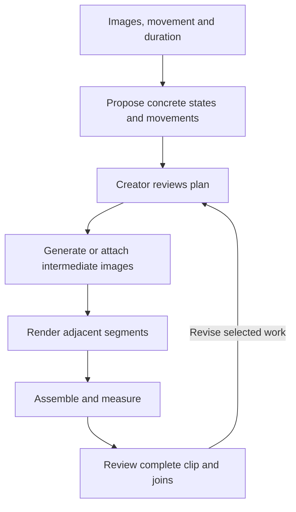

# vid-build: Super Shot completion contract and coding-agent implementation guide

Date: 2026-09-23  
Baseline: supplied 249-file snapshot, `e4211785-bd05-47cf-b7a0-41d6c359cf95.txt`  
Purpose: finish the existing implementation and correct observable failures.  
Authority: this document supersedes conflicting Super Shot instructions in the earlier correction document, including its Revision 2. Earlier specifications still govern unrelated features. This is a single implementation contract; do not maintain competing interpretations.

## 1. Read this first

The adjacent-anchor structure is now present. Keep it. The remaining work is to connect creative planning, image generation, immutable execution inputs, reliable retry, lifecycle management and measured assembly into a usable path.

The creator must be able to describe a 2–30 second video using a first image, a last image and a movement prompt. The application must either produce one supported generation or propose meaningful intermediate images and movement prompts for a chain. The creator can inspect, edit and render that plan.

A chain is A→B, B→C, C→D. Each segment retains a first image, last image, movement prompt and negative prompt. Motion context, where supported, is an additional input. A schema column or disabled dropdown does not constitute an implemented context adapter.

Do not mistake a structural placeholder for a creative proposal. “A plausible state halfway through the shot” is an instruction to a planner, not a usable description of an image.

[Review limitation: findings below come from source inspection. No Go test suite or real ComfyUI generation was run during preparation of this document. Reproduce findings against the actual checkout before changing code; report any already-fixed differences.]

## 2. Change / preserve contract

| Area | MUST PRESERVE | MUST CHANGE |
|---|---|---|
| Architecture | Go, SQLite, Chi/templ, HTMX, daisyUI; existing app structure | Repair existing services and routes; add only necessary fields/services |
| Model execution | Imported ComfyUI API graphs with semantic bindings | Select explicit compatible image/video workflows; validate bindings before dispatch |
| Story hierarchy | Project, video, scene/beat, shot and existing storyboard | Super Shot stays a rendering plan for one perceived shot; no new mandatory narrative level |
| Basic creator inputs | First image, last image, movement prompt, negative prompt | Preserve all of them in compiled requests; never silently substitute shot purpose for movement |
| Anchor chain | N+1 anchors for N adjacent segments | Supply real intermediate descriptions/images; preserve reference identity and continuity |
| Duration | 2–30 second request range; shot default; convenience presets | Correct workflow frame math and rational FPS through final assembly |
| Planning UI | Draft review before production; editable states/actions | Remove placeholder approval, preserve submitted values, expose errors and capabilities |
| Queue | Durable existing queue and worker | Attempt-specific jobs, transactional dispatch, cancellation checks, revision guards |
| History | Existing assets, receipts, attempts and approvals | Immutable run inputs and explicit current selections; retain superseded work |
| Context | Honest unavailable status until verified | Implement and demonstrate at least one supported context path; report blocked modes accurately |
| Unrelated app features | Auth, workspace boundaries, storyboard, animatic, review, edit, backups | Only alter shared code when required, with regression checks |
| Existing databases | User projects/assets and historical migrations | Forward migration; versioned workflow upgrade; legacy plan diagnosis |

Do not switch databases, introduce PocketBase, rewrite the frontend, build a new membership system, replace ComfyUI with Go sampling code, delete project data, or erase outputs to simplify migration. Do not “solve” the problem by requiring the creator to manually author every intermediate image. Manual authoring must be a supported option, while assisted planning remains a required deliverable.

## 3. How to think about the program

### 3.1 Five distinct objects

| Object | Meaning | Example |
|---|---|---|
| Creative shot | What the creator wants the audience to see | Person walks to a chair, turns and sits |
| Plan revision | Editable proposal for achieving the shot | Four visual states and three movements |
| Execution attempt | One immutable set of inputs submitted to a workflow | B image + C image + movement + seed + graph |
| Asset | Output bytes with metadata and provenance | Intermediate image, segment MP4, final MP4 |
| Selection | Which candidate is currently used | Segment 2 uses attempt 4's video |

A segment is a temporal part of the shot. A candidate is an alternative for that same part. A retry creates another attempt. These relationships must remain distinct even if they share existing request tables.

The application must distinguish “requested,” “planned,” “submitted,” “rendered,” “measured,” and “accepted.” One status named success cannot prove all six.

### 3.2 Prompt levels: no terminology substitution

| Purpose | Description |
|---|---|
| Shot purpose | Why this shot exists and the audience effect |
| Complete-shot movement | What visibly happens from the supplied first image to last image |
| Anchor image prompt | What a particular boundary image should show |
| Segment movement prompt | What happens between two adjacent boundary images |
| Negative prompt | Unwanted visual or motion characteristics, mapped to supported inputs |

Store purpose and complete movement separately. Include both as distinct context fields for the planner. The worker gets the interval's movement prompt plus relevant continuity context. It must not repeat the entire action at every interval.

### 3.3 Worked example

Creator: first image A shows a person standing near a chair; last image D shows them seated. Movement: “Walk to the chair, turn and sit naturally.” Target: 15 seconds.

The actual number of segments comes from workflow timing. If three segments are feasible:

| Boundary/interval | Meaning |
|---|---|
| A | Supplied standing person, same room and chair |
| A→B | Approach chair at steady pace |
| B | Person beside chair, still moving, beginning turn |
| B→C | Turn and start lowering toward seat |
| C | Knees bent, body partway through lowering |
| C→D | Continue lowering and settle into supplied seated pose |
| D | Supplied final image |

Intermediate states describe pose, position, relevant objects and camera composition. They preserve identity, clothing and room references. The boundary does not force a pause. A hold or cycle is also valid when intended.



## 4. Confirmed implementation problems and required repairs

### C01 — Complete movement can be lost during compilation

**Evidence:** `internal/video/plan.go`, `compileMovementPrompt`, chooses `firstNonEmpty(in.ShotIntent, in.BasePositive)`. The web handler passes `shot.Purpose` as `ShotIntent`. When purpose is nonempty, the complete movement prompt is omitted from this field; default segment actions do not restore it.

**Repair:** preserve both fields. Pass the full movement to the creative planner and use explicit per-segment movements in generation. Test purpose “show confidence” alongside movement “walk to chair and sit”; both must reach the appropriate stage without one replacing the other.

### C02 — Placeholder states are treated as executable plans

**Evidence:** `BuildPlan` supplies “Intermediate state ... a plausible visible state ...”; approval accepts nonempty text. The form claims the app proposes states. Warnings are held on `ChainPlan`, but the persisted page view does not reconstruct those warnings.

**Repair:** integrate the existing LM Studio planner with a schema-validated Super Shot proposal. Inputs include shot purpose, complete movement, endpoint descriptions, duration/frame boundaries, continuity references and user constraints. A vision-capable model may inspect images when configured; text-only planning must retain creator descriptions and must not claim to have inspected pixels.

Return concrete boundary descriptions and separate movement instructions. Store proposal provenance, warnings and validation status. Unknown/missing planner output creates a visibly incomplete draft. Do not queue placeholder prompts. Offer manual states/actions when the planner is unavailable, preserve input, and show the actual service error.

**Acceptance:** a blank intermediate-state form produces meaningful descriptions through a fake planner integration test and a real configured planner demonstration. “No planner” never silently becomes a generic image-generation prompt.

### C03 — Intermediate-image generation lacks visual references

**Evidence:** `internal/worker/video.go`, `GenerateAnchor`, supplies text, dimensions and seed only. `pickImageWorkflow` picks the first image package. Endpoint images and continuity references are not bound. It can also apply the plan's model checkpoint to this arbitrarily chosen image workflow.

**Repair:** select and persist a separate image-workflow version/model profile for intermediate images. Validate reference-image/editing capability. Stage endpoint images and appropriate character/style/previous-anchor references through declared bindings. Include the concrete state and relevant continuity descriptions. Never put the video model checkpoint into the image workflow automatically.

Provide attach/select-existing-image controls as a genuine supported path. Validate image MIME/decoded type and workspace/project scope. Do not relabel a video result as PNG. Capture image-generation attempts, seeds and graph receipts just as for video attempts.

**Acceptance:** inspect the submitted mock-Comfy graph and prove reference assets, state text and the image checkpoint reach it. Real demonstration must retain the intended person/object and setting across A/B/C/D.

### C04 — Attempt link is cleared when rendering starts

**Evidence:** `RunSegment` loads the segment and then calls `SetSegmentRunning(..., "")`. The store writes `attempt_id=NULL`. The worker receives the previously loaded struct, which may still contain the old ID. Thus a success receipt may be written while the segment's persisted attempt link is lost. This corrects the earlier review's overly broad suggestion that the first run necessarily lacks a receipt.

**Repair:** queue and claim a concrete attempt ID. Starting execution must retain that ID. Write running, failed and successful attempt states consistently. Link assets to the same attempt and preserve historical attempts. Do not create an unused request-level candidate followed by unrelated attempts unless its role is explicitly meaningful.

**Acceptance:** after success and failure, reload from SQLite and verify job → attempt → segment/output relations. A retry creates a different attempt and leaves the original terminal receipt unchanged.

### C05 — Retry and reassembly can reuse a terminal job

**Evidence:** retries use keys such as `supershot:<request>:segment:<index>`. `EnqueueJob` returns any job with that key, including failed/succeeded jobs. Anchor and assembly keys have the same lifetime problem.

**Repair:** job identity includes immutable attempt or assembly revision. Example: `segment:<segment-id>:attempt:<attempt-id>`. Duplicate submission of the same attempt returns its existing job; an explicit retry creates a new attempt and key. An assembly key identifies the selected input snapshot/revision. Handle unique-key races atomically.

**Acceptance:** run the actual queue with a fake adapter. Fail a segment; invoke retry through HTTP; claim and execute the NEW job; finish the chain. Test successful reassembly after changing a selected input. Calling `RunSegment` directly is insufficient proof of retry.

### C06 — Edits do not keep outputs and prompts current

**Evidence:** `UpdateAnchorState` and `UpdateSegmentAction` update text without draft-state restrictions or dependency invalidation. `ChangeAnchor` exists but is not called by the anchor-edit handler. Compiled movement prompts contain copied state descriptions, which can become stale after edits. `InvalidateAssembly` retains the asset pointer; the page displays it based on pointer presence alone. Retry display checks `Status == "stale"`, while staleness is stored as a boolean.

**Repair:** retain raw interval action separately from compiled prompt. Recompile after approved edits; preserve explicit user prompt overrides with a clear stale warning instead of silently overwriting them. Draft edits remain cheap. Editing an executed plan creates a new revision or marks exact outputs stale. Regenerated anchors invalidate adjacent segments; context dependencies extend that closure. Historical output may remain visible only as clearly labelled previous output. Use `seg.Stale` in retry controls.

Late results from an old revision must never clear staleness or become the current output. Every completion is conditional on the expected attempt/revision/input snapshot.

### C07 — Approval and cancellation are not execution barriers

**Evidence:** cancel sets the parent status only. Worker/ready-dispatch paths do not enforce cancelled state. Individual anchor generation can call `AnchorReady`, which schedules video segments without checking parent approval. The approval handler uses the freshly loaded revision, rather than the revision the user saw.

**Repair:** guard all mutations and dispatch centrally in the service. Before approval, permit explicit image previews if desired, but never automatically dispatch video segments. Approved generation operates on a frozen plan revision. Cancellation prevents future claims/submissions and descendant dispatch. An in-flight result may be retained as history; it cannot uncancel the plan. Attempt best-effort provider cancellation only when supported.

Approval carries the displayed revision and conflicts when stale. Anchor/segment changes must update the parent revision atomically. Retry, resume, generate-missing and assembly enforce these rules too.

### C08 — Timing, FPS and measured duration are not yet reliable

**Evidence:** assembly passes only `FPSNum` to `exporter.New`. If probing fails, `actual` remains the planned duration, which is then reported as measured. Verification permits a fixed minimum 250ms discrepancy while its message says one frame. The frame adjustment helper claims nearest rounding but preferentially snaps upward. The solver can clamp requests to available frame bounds and does not fully search alternative valid partitions.

**Repair:** preserve numerator/denominator through FFmpeg arguments and receipts. Use integer output-frame budgets and workflow-specific window/endpoint conventions. Separate requested duration, feasible planned duration, generated frames, contributed frames and measured output. Solve constraints including minimum duration, frame rules, maximum window and any context overhead. Do not silently change forced strategy or truncate to a much shorter direct clip.

Report feasible alternatives before approval when exact duration cannot be represented. Do not infer whether 41 encoded frames mean a five-second endpoint interval or 5.125 seconds of container playback without testing the actual graph.

Probe failure must produce an unverified/failed delivery state, never synthetic measured time. Derive tolerance from output frame duration plus a documented small container allowance. Include frame count, FPS, dimensions and actual duration in the asset metadata. Verify the last intended state survives any declared trims.

### C09 — Existing installations may never receive capabilities

**Evidence:** `SeedBundledWorkflow` returns immediately when the package already has a version. Updating the bundled manifest on disk does not update an existing SQLite workflow version. Planning now requires capability metadata, so upgraded installations with old manifests can be blocked.

**Repair:** add an idempotent versioned workflow upgrade/import path. Preserve historical immutable versions and requests. Insert the new manifest/bindings as a new version, expose it for new requests, and show its verification status. Do not rewrite the old version or require resetting the database. Test upgrade from a database containing the previous bundled workflow.

### C10 — Parent status, errors and legacy visibility need completion

**Evidence:** the shown service changes parent status to generating states but does not reliably propagate all terminal assembly/worker states to it. Error fields are prepared for display but absent from the visible anchor/segment rows. Legacy detection helpers/flags exist; actual migration/use must be traced.

**Repair:** define parent state aggregation and update it transactionally with meaningful child transitions. Parent success requires a current measured assembly. Preserve parent cancellation over late results. Show error text, recovery action and stale state. Diagnose old repeated-endpoint plans without deleting their outputs; surface them as legacy work requiring re-planning. Ensure selected assembled videos can enter the ordinary Review/Edit flow.

### C11 — Persistence still spans partial operations

**Evidence:** `CreateSuperShotPlan` calls `CreateGenerationRequest` before opening its plan transaction. Approval and retry create/update work in separate steps.

**Repair:** use shared transaction helpers to persist linked entities and queue intent together, or an outbox where necessary. A failed insertion must not leave an approved plan with no dispatch and no recovery. External submission happens after commit. Persist provider request IDs and reconcile on restart before resubmission to reduce duplicate expensive work.

## 5. Context chaining: required capability work

Keep the current honest unavailable label until a tested adapter exists. Complete the following work explicitly; do not count the existing schema as completion:

1. Inspect installed workflows, custom nodes and models. Identify a graph accepting predecessor context AND the current last image.
2. Run it independently with a simple two-segment example. Save graph, versions, inputs and results.
3. Implement typed semantic bindings for tail frames or supported native temporal latents. Go orchestrates artifacts; ComfyUI performs sampling.
4. Persist context with producer attempt, source checksum, model/VAE fingerprints, layout, dimensions, FPS and exact frame ranges.
5. Schedule consumers only after the selected producer context validates. First segment has no predecessor; later segments depend on the chosen attempt.
6. Changing that selected output invalidates transitive descendants. A context reset is an explicit plan decision.
7. Record whether output contains new frames only, prefix+new frames or an entire extended clip. Assemble declared unique ranges once.
8. Compare joins against anchor-only generation using controlled inputs and several trials. Record human review and actual cost/time.

A workflow supporting extension alone does not satisfy final-image conditioning. Do not discard the supplied end image to enable context. Native latent support requires actual export/import/conditioning tests; decoded-tail support must be labelled tail-frame context.

If the required graph/model is absent, provide an exact blocker report: missing component, attempted graph, observed error and required setup. Continue completing independent app repairs. Mark context incomplete until evidence exists.

[Suggestion: validate a tail-frame workflow first if available, while keeping native latent as a separately testable capability. Neither should be assumed universally superior without a comparison.]

## 6. Implementation guide and responsibility boundaries

### 6.1 Files to inspect and change

| Files | Responsibility |
|---|---|
| `internal/video/plan.go` | Creative plan validation and prompt composition; remove executable placeholders |
| `internal/planner/planner.go` | Structured assisted proposal using existing LLM client |
| `internal/video/timing.go` | Feasible frame budget/partition solver |
| `internal/video/video.go` | State guards, attempts, dependencies, approval/retry/cancel/resume |
| `internal/store/supershot.go`, `video.go`, `production.go` | Transactional persistence, workflow upgrades, attempt/job identity |
| `internal/worker/video.go` | Explicit image/video adapters, provider receipts and context staging |
| `internal/exporter/ffmpeg.go` | Rational FPS, exact ranges, media probing and output receipts |
| `internal/workflows/capabilities.go`, bundled manifests | Validated capabilities and versioned graph contracts |
| `internal/web/handlers_supershot.go` | Authorized orchestration through services; submitted revision handling |
| `internal/templates/supershot.templ` | Inputs, preview, errors, stale work and supported choices |
| New forward migration after `0008_super_shot.sql` | New fields/relations only; preserve migration history |
| Existing tests plus focused new tests | Prove user-visible outcomes through real service/queue paths |

Regenerate templ outputs using the repository toolchain. Do not hand-edit generated Go templates. The coding agent may add small domain files to keep responsibilities clear; a wholesale rewrite is outside this task.

### 6.2 Minimal data additions

Adapt existing tables rather than introducing duplicate request systems. Ensure representation of:

- parent plan revision and immutable execution snapshot;
- separate shot purpose, complete movement, raw segment action and compiled prompts;
- planner provenance, persisted warnings and incomplete/validated proposal status;
- separate intermediate-image workflow/model selection;
- attempt → segment/anchor relation and selected output attempt;
- job → immutable attempt/revision link;
- assembly input revision/hash and measured/unverified state;
- context consumer → producer attempt/artifact dependency;
- cancellation and supersession outcomes.

SQLite metadata points to managed asset bytes. Old images/videos remain readable. Add scope checks and foreign keys/checks where supported; validate cross-row invariants in transactional services.

### 6.3 Main user path

1. Open shot; show its selected first and last images, purpose, movement and duration.
2. Choose compatible video workflow. Show supported FPS and verification status. Choose an image workflow only when missing anchors require one.
3. Propose plan. Show concrete states, movement prompts, requested/planned duration and any adjustment.
4. Creator edits or accepts. Unresolved placeholders block production with clear reasons.
5. Generate reference-conditioned intermediate images or attach images. Review can be batched. Optional image previews must not silently start video generation.
6. Approve the current plan/input revision and render. Show anchors, segments and errors throughout execution.
7. Assemble current outputs, measure file and inspect joins.
8. Select the result as the shot's video candidate and use normal Review/Edit/Export.

### 6.4 Occasional paths

Retry a failure; regenerate a poor intermediate image; change a movement prompt; choose another take; cancel/resume; upgrade/import a workflow; benchmark context; inspect receipts. Each has explicit consequences shown before expensive dependent regeneration. Preserve unrelated work.

### 6.5 HTTP contract

Retain current `/super-shots` routes and `/duration` compatibility routing. Existing new/plan/view/approve/anchor-edit/anchor-generate/segment-edit/retry/assemble/cancel endpoints must call guarded services. Add explicit attach/select anchor asset, resume, select segment attempt and join-review routes where absent. Use the app's established POST/method-override conventions consistently.

Each mutation includes expected revision and checks workspace/project/video/request ownership. Incompatible input returns an actionable error with preserved form values. The browser must not report “queued” when it only received an old terminal job.

## 7. Acceptance tests: exact outcomes

| ID | Scenario | Required proof |
|---|---|---|
| T01 | Purpose and movement differ | Both retained; movement reaches correct interval compilation |
| T02 | Planner unavailable | Incomplete draft, useful error, zero accidental generation jobs |
| T03 | Assisted three-segment proposal | Four concrete states; A→B/B→C/C→D; reviewable movements |
| T04 | Intermediate-image render | Submitted graph contains reference images and correct image profile |
| T05 | Worker succeeds/fails | Reloaded attempt link intact, correct terminal receipt and asset provenance |
| T06 | Failed job retried through UI | New attempt/key is claimed and executed; old job remains terminal |
| T07 | Two simultaneous identical submissions | One job for same attempt; no duplicate generation |
| T08 | Edit anchor/movement after render | Correct dependent outputs stale; assembly not presented as current |
| T09 | Old render finishes after edit | Old asset retained as history; cannot overwrite current selection |
| T10 | Image preview before approval | No motion jobs auto-dispatched |
| T11 | Cancel with queued work | No subsequent provider submissions or descendant dispatch |
| T12 | Stale browser approval | Conflict; cannot approve unseen revision |
| T13 | Rational FPS e.g. 30000/1001 | Same rate in plan, workflow and FFmpeg output where supported |
| T14 | Probe unavailable/fails | No fabricated measured duration or verified success |
| T15 | Requested duration infeasible | Explicit feasible proposal/rejection; no silent major clamp |
| T16 | Existing installation upgrade | New workflow version usable; prior graph/requests remain intact |
| T17 | Successful assembly | Parent success, measured metadata, usable Review/Edit selection |
| T18 | Failure display | Actual error and functioning recovery action in page |
| T19 | Context mode | Producer dependency, validated artifact, no duplicated overlap frames |
| T20 | Context take replaced | Transitive descendants stale; upstream and unrelated work preserved |
| T21 | Restart/partial transaction failure | No orphan dispatch; submitted provider work reconciled |
| T22 | Scope/auth | Existing cross-workspace and CSRF restrictions retained on new actions |

Tests must exercise handlers → service → SQLite queue → worker adapters for lifecycle claims. A fake ComfyUI endpoint can capture submitted graphs and return small fixture media. Do not test retry by calling the service directly while bypassing queue claiming.

Real GPU acceptance: direct short clip, meaningful chained 15-second clip, chained 30-second clip, failed-attempt recovery, and context comparison if that mode is implemented. Save workflow/model versions, graph/input hashes, seeds, frame counts, actual duration and playable files. Unit success does not establish visual continuity.

## 8. Delivery sequence

1. Read this contract and inspect the actual checkout; identify any baseline differences.
2. Add focused failing regression tests for prompt preservation, attempt identity, retry, cancellation and truthful measurement.
3. Repair transactions, immutable attempts/jobs and lifecycle guards.
4. Connect structured creative planning and reference-conditioned intermediate images.
5. Correct frame solver, rational FPS and measured assembly.
6. Finish UI error/retry/stale/selection flows and existing-installation upgrade.
7. Verify and implement context adapter, or produce a precise external blocker while finishing the other work.
8. Run targeted tests, repository tests and required real demonstrations where hardware is available.
9. Update manuals and both end-user/evaluator presentations with actual supported behavior.

Do not introduce another large planning framework. Complete the existing path. Each implementation claim must point to running code and a meaningful test or demonstration.

## 9. Required final report from the coding agent

Provide:

- requirement IDs C01–C11 and T01–T22 with implemented/verified/blocked status;
- changed files and migration/upgrade instructions;
- exact tests run and failures/skips, including missing GPU integrations;
- imported workflow package/version and remaining context limitations;
- playable 15/30-second outputs and join review notes when rendered;
- current user steps for producing the clip;
- any departure from this contract, its reason and user-visible effect.

Never describe planned duration as measured, placeholder prose as a creative proposal, a context table as an adapter, or an existing terminal job as a new retry.

## 10. Copy/paste introduction for the coding agent

```text
Implement docs/specs/vid-build-super-shot-completion-contract.md against the
current repository. It supersedes conflicting earlier Super Shot instructions.
Read it fully, including the change/preserve table and worked example.

Keep the existing adjacent-anchor chain and application architecture. Finish
meaningful assisted planning, reference-conditioned intermediate images,
movement-prompt preservation, immutable attempt/job identity, working retries,
state guards/cancellation, measured timing and existing-installation upgrades.
Verify context through a real compatible ComfyUI graph; report blocked modes
honestly and continue all independent work.

First give a brief file/requirement map, then implement. Do not stop after the
map. Prove lifecycle behavior through the actual queue and HTTP paths. Preserve
user data, historical assets and working unrelated features. Finish with the
requirement/test status report specified in section 9.
```
