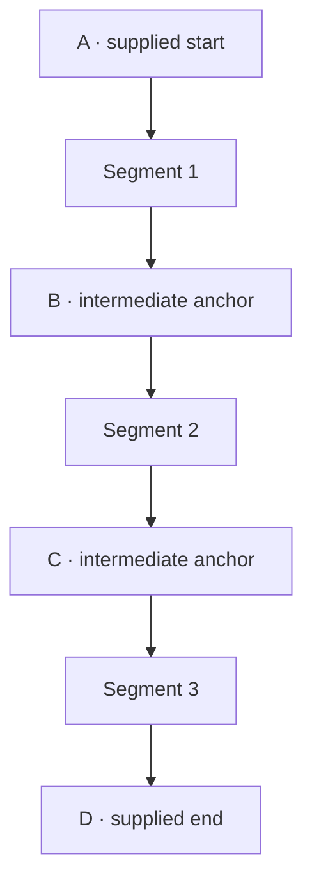
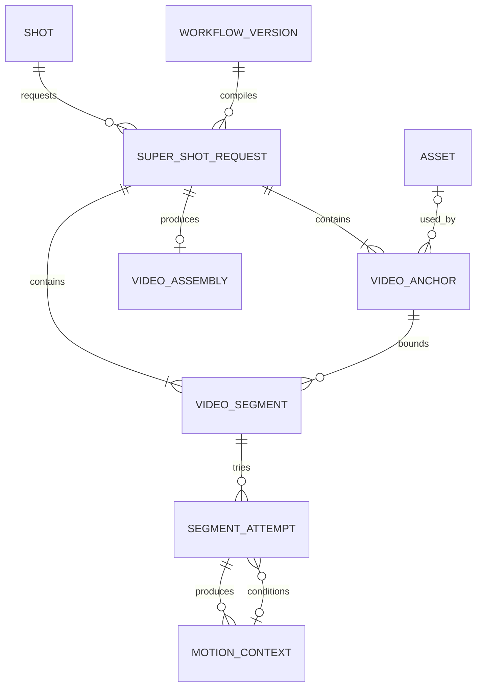
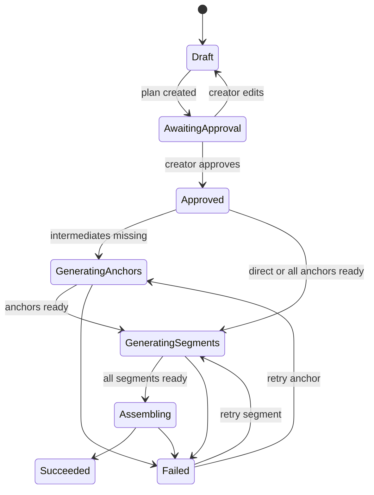
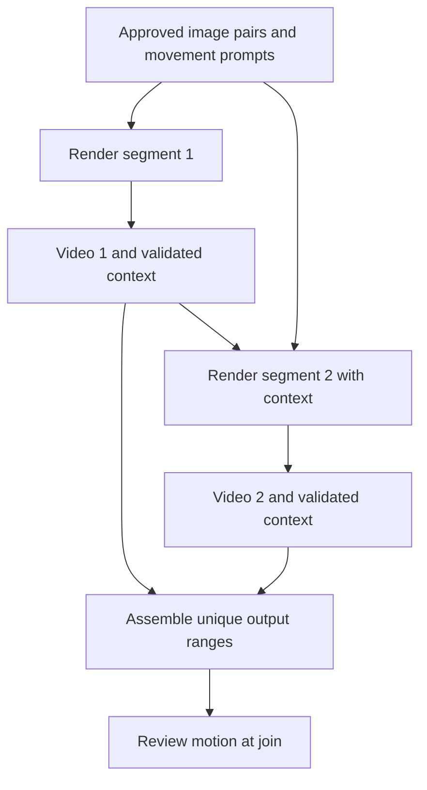

# vid-build Change Specification

## Revision 2 — First/Last Images, Motion Prompts, and Context Chaining

**Document type:** Corrective implementation specification  
**Target:** vid-build / vide-o-matic 0.02 codebase  
**Priority:** P0 — correct chaining; add verified motion context support  
**Audience:** coding agent implementing and verifying the correction  
**Revision:** 2 · 2026-09-23  
**Status:** Implementation contract; native context support requires a verified workflow  
**Review scope:** Static review of the supplied repository snapshot and the previous specification. No new application build or real GPU render was performed. Root-cause explanations are hypotheses, not a reconstruction of the coding agent’s reasoning.  

---

## 1. Executive instruction

Replace the current duration-video planner. It presently creates every segment with the same approved start and end assets. A 15-second request therefore becomes `A→D, A→D, A→D`; a 30-second request becomes six repetitions of `A→G`. That is not a chained long shot.

The intended feature is a **Super Shot**: one perceived shot, 2–30 seconds long, generated directly when the selected workflow can do so reliably or divided into consecutive bounded segments when necessary. A chained result must progress through an ordered series of visual states:



The non-negotiable continuity invariant is:

```text
segment[i].end_anchor_id == segment[i+1].start_anchor_id
```

After an anchor has an asset:

```text
segment[i].end_asset_id == segment[i+1].start_asset_id
```

Do not simulate progression by appending labels such as “opening,” “development,” or “climax” to identical A→D requests. Each segment must describe and render a distinct adjacent state transition.

[Implementation note: preserve the existing job queue, isolated segment retry, asset lineage, and FFmpeg assembly where they remain correct. Replace the planning semantics and add the missing anchor lifecycle.]

---

## 2. Product meaning

### 2.1 A shot owns the creative duration

The shot's `duration_target_ms` is the normal source of truth. The Super Shot screen may let the creator override it for a particular generation request, but 5, 15, and 30 seconds are presets—not the domain model and not the only allowed values.

Support a requested duration from **2.0 through 30.0 seconds**, stored as integer milliseconds. Do not use an integer-seconds-only API.

The selected workflow determines:

- whether the whole requested duration can be generated directly;
- its permitted/minimum/maximum frame counts;
- its frame-count rule, such as `4n+1`;
- supported FPS values;
- whether it accepts a start image, an end image, or both;
- its preferred/reliable segment duration;
- whether generated continuation and intermediate anchors are supported.

The shot determines what should happen and how long the audience should experience it. The workflow determines how that intent must be compiled for a particular model.

### 2.2 Two valid execution strategies

1. **Direct:** one model invocation for the complete requested duration when the workflow declares it supported.
2. **Chained:** divide the shot into adjacent segments and introduce `segment_count - 1` intermediate anchors.

[Suggested later extension: a hybrid strategy may attempt a direct render and repair only weak ranges, but it is not required for this correction.]

### 2.3 Main path and exceptional path

**Expected main path:**

Direct shots should retain a compact preview-and-render flow. For chained shots, the app proposes the intermediate images and movement prompts; the creator can review them together. Manual editing and individual image approval are available without requiring repetitive per-segment form entry.

1. Open a shot whose start and end frames are selected and approved.
2. Open **Super Shot**.
3. Confirm or override the shot duration.
4. Select a workflow/model profile.
5. Enter or inherit the motion prompt and negative prompt.
6. Ask the planner to create a segment/anchor plan.
7. Inspect and optionally edit intermediate states and segment actions.
8. Approve the plan.
9. Generate missing intermediate anchors.
10. Generate adjacent video segments.
11. Inspect the assembled video and retry only weak anchors or segments.

**Occasional/model-research path:**

- run a controlled duration ladder against a workflow;
- capture generation time, observed VRAM, cost, endpoint adherence, identity consistency, temporal stability and human notes;
- update observed workflow capability without silently changing historical requests.

[Improvement: keep model benchmarking visible as an advanced action rather than putting experimental controls in the everyday production form.]

---

## 3. What went wrong in the current implementation

This was not caused by one bad line. The implementation followed a locally convenient but globally incorrect model:

1. The requirements said “fixed five-second anchor-to-anchor segments,” but the code had only two endpoint assets and no persisted intermediate-anchor entity.
2. `Service.Plan` therefore assigned `in.StartAssetID` and `in.EndAssetID` to every segment.
3. `SegmentPrompt` added phase labels, making the generated rows textually distinct without defining different visual states or bounded actions.
4. `TestPlanCreatesSegmentsWithEndpointReuse` explicitly asserted that every segment reused both outer endpoints. Once this test existed, the semantic error became protected behavior.
5. The urgent 5/15/30 deliverable encouraged a mechanically complete vertical slice—queue, retry, assembly, UI—before the underlying long-shot model was represented.
6. Documentation then described the implemented shortcut as the feature, rather than testing it against the creative requirement.

The earlier intent was clear at the product level: longer shots were to be made from more segments **between** the first and last frame. The missing implementation detail was how intermediate anchors were proposed, approved, generated, and shared. The resulting implementation filled that gap with endpoint reuse. The snapshot proves the behavior, but cannot establish what instructions the coding agent saw or why it chose this approach.

[Process improvement: acceptance criteria must assert relationships and state changes, not merely counts. “Six segments exist” is insufficient; the test must prove an A→B→C→D→E→F→G chain.]

---

## 4. Current defects and nearby drift

### 4.1 P0: repeated outer endpoints

In `internal/video/video.go`, every `store.SegmentInput` receives the original `StartAssetID` and `EndAssetID`. Correct this completely.

### 4.2 P0: no intermediate anchor lifecycle

The schema contains `video_segments`, but no first-class duration-plan anchor records. Add them. An intermediate anchor needs a time position, state description, generation status, optional asset, revision, and lineage.

### 4.3 P0: artificial prompt variation

Delete `SegmentPrompt` as the creative planner. A phase suffix is not a segment action. Segment prompts must be compiled from:

- the overall shot action;
- the segment's start state;
- the segment's end state;
- the bounded action/change occurring only in that interval;
- continuity locks;
- negative prompt layers.

### 4.4 P0: durations hard-coded to 5/15/30

`AllowedDurations`, the integer `duration` form field, and the fixed options contradict the required 2–30 second range and the existing shot duration model. Replace them with `duration_ms`, defaulted from `shots.duration_target_ms`, validated to `2000..30000`.

Presets for 5, 15 and 30 seconds may remain as convenience buttons.

### 4.5 P0/P1: frame math is in the wrong layer

`Frames(fps)` rounds `fps * 5` to a multiple of four. The bundled Wan workflow appears to use lengths such as 25 and a step of four, which strongly suggests a `4n+1` constraint rather than a multiple of four. More importantly, no generic video service can assume one universal rule.

Move frame validation and normalization into workflow capability data. Do not guess silently. If the workflow lacks timing capability metadata, block planning with a clear message or require an explicitly confirmed legacy profile.

[Check the exact effective-duration convention of the installed Wan graph before selecting 41 versus 40 frames at 8 FPS. Encode the verified convention in the workflow adapter and test it with the real graph.]

### 4.6 P1: rational FPS is discarded

`handlers_duration.go` passes `float64(vid.FPSNum)` and ignores `FPSDen`. Use `float64(FPSNum) / float64(FPSDen)` with denominator validation. Prefer carrying rational FPS in the domain and converting only at workflow/FFmpeg boundaries.

### 4.7 P1: workflow eligibility is checked too late

The UI says the workflow “must declare first/last frame bindings,” yet it lists all selectable workflow versions. The worker does reject missing first/last bindings in `GenerateSegment`, so validation is not absent altogether. Move this check into preflight as well. Filter or disable incompatible workflows and validate timing before paid or expensive dispatch.

### 4.8 P1: the UI skips plan review

The current POST immediately queues generation. The new process must first persist a **draft plan** and display it. Generation begins only after explicit plan approval.

### 4.9 P1: weak web acceptance coverage

`duration_test.go` proves only that the page renders and that missing endpoints are rejected. Add a successful authenticated POST, workspace/project/video authorization checks, workflow-capability rejection, plan review, approval, anchor generation, segment generation and assembly coverage.

### 4.10 P1: concatenation is not automatically a seamless shot

Plain FFmpeg concatenation makes one playable file, but does not itself hide discontinuities. For the first corrected version, preserve hard concatenation and expose joins during review. Do not call the result seamless unless tested.

[Suggested improvement: later add configurable boundary overlap/crossfade or optical-flow repair as workflow capabilities, not as unconditional assembly behavior.]

### 4.11 P2: documentation/version drift

The repository identifies the product as both 0.01 and 0.02, and user documentation describes 5/15/30 as exact limits. Update all duration documentation and settle the displayed version in one shared constant/build value.

---

## 5. Required domain model

### 5.1 Relationship model



### 5.2 `super_shot_requests`

Either add this table or deliberately extend `generation_requests` with an associated one-to-one plan table. Do not bury the lifecycle only in opaque JSON.

Required fields:

```text
id
generation_request_id nullable until execution request exists
workspace_id
project_id
video_id
shot_id
workflow_version_id
model_profile_id nullable
strategy                 direct | chained
requested_duration_ms
planned_duration_ms
fps_num
fps_den
width
height
base_positive
base_negative
status                   draft | awaiting_approval | approved |
                         generating_anchors | generating_segments |
                         assembling | succeeded | failed | cancelled
plan_version
created_by_user_id
created_at
updated_at
revision
```

### 5.3 `video_anchors`

```text
id
super_shot_request_id
idx                       0..segment_count
time_offset_ms
kind                      supplied_start | intermediate | supplied_end
state_prompt
negative_prompt
continuity_json
status                    planned | approved | queued | running |
                          succeeded | failed
asset_id nullable
source_anchor_id nullable  for regeneration/derivation lineage
error
created_at
updated_at
revision
UNIQUE(super_shot_request_id, idx)
UNIQUE(super_shot_request_id, time_offset_ms)
```

The first and last anchors reference the approved supplied endpoint assets. Intermediate anchors may reference existing creator-supplied images or begin without assets. An optional separate image workflow generates missing images; the video workflow need not generate stills.

### 5.4 Revised `video_segments`

Add:

```text
super_shot_request_id
start_anchor_id NOT NULL
end_anchor_id NOT NULL
start_offset_ms
end_offset_ms
duration_ms
action_prompt
continuity_json
```

Retain resolved `start_asset_id` and `end_asset_id` only if useful as immutable execution receipts. The anchor IDs are authoritative at planning time; asset IDs should be resolved after anchors succeed and recorded with the attempt.

Do not use `REAL fps` as the sole timing representation in new records. Store numerator and denominator or inherit them from the request.

### 5.5 Workflow capability

Add versioned capability metadata, not application constants:

```json
{
  "video_timing": {
    "minimum_duration_ms": 2000,
    "maximum_direct_duration_ms": 5000,
    "preferred_segment_duration_ms": 5000,
    "minimum_frames": 17,
    "maximum_frames": 121,
    "frame_rule": { "type": "modulo", "modulus": 4, "remainder": 1 },
    "supported_fps": [{ "num": 8, "den": 1 }, { "num": 16, "den": 1 }]
  },
  "inputs": {
    "start_image": true,
    "end_image": true
  },
  "continuation": {
    "mode": "anchor_only"
  }
}
```

[Suggestion: capabilities should belong to an immutable workflow version. Observed benchmark results should be separate records so measured experience does not rewrite what an old request declared.]

---

## 6. Planning algorithm

### 6.1 Inputs

```go
type PlanInput struct {
    WorkspaceID, ProjectID, VideoID, ShotID string
    WorkflowVersionID, ModelProfileID       string
    RequestedDurationMS                     int
    FPSNum, FPSDen                          int
    Width, Height                           int
    Positive, Negative                      string
    StartAssetID, EndAssetID                string
    PreferredStrategy                       string // auto, direct, chained
}
```

### 6.2 Validation

Reject unless:

- request duration is 2000–30000 ms;
- the shot belongs to the addressed video/project/workspace;
- start and end assets are selected, approved and belong to that shot/project;
- identical start/end assets are allowed for intentional holds, cycles or returning motion; warn about accidental duplication and ask for an intent label, rather than banning valid shots;
- workflow version is selectable and has the required image bindings;
- workflow timing capability can represent the planned segment durations/frame counts;
- FPS denominator is positive;
- dimensions satisfy workflow requirements;
- prompt/settings payload sizes are bounded.

### 6.3 Strategy selection

In `auto` mode:

```text
if requested_duration_ms <= maximum_direct_duration_ms
and workflow supports both supplied endpoint bindings:
    strategy = direct
else:
    strategy = chained
```

If the user forces an unsupported strategy, return a visible validation error; do not silently substitute.

### 6.4 Chained segment boundaries (conceptual example; frame solver in section 15 is authoritative)

Choose feasible segment boundaries using frame constraints, minimum durations, preferred lengths and context overhead. The following millisecond example illustrates distribution only; it is not the executable timing algorithm.

Example for 14,000 ms with a 5,000 ms maximum:

```text
segment_count = ceil(14000 / 5000) = 3
boundaries_ms = [0, 4667, 9333, 14000]
durations_ms  = [4667, 4666, 4667]
```

Do not round the complete shot to 15 seconds. Keep requested time separately from frame-quantized planned time. Derive authoritative boundaries from integer output frame ranges as specified in section 15.

### 6.5 Anchor-state planning

For `N` segments, produce `N+1` ordered anchor states:

- anchor 0 uses the supplied start image and describes what is visibly true at time 0;
- anchor N uses the supplied end image and describes what is visibly true at the requested ending;
- anchors 1..N-1 describe plausible intermediate visible states;
- each adjacent pair has one bounded action statement explaining what changes;
- continuity locks identify what must not change unexpectedly.

An LLM may propose the plan, but the response must be schema-validated and presented to the creator. A deterministic fallback may distribute a creator-supplied ordered list of actions, but it must never invent identical A→Z segments.

Required planner output:

```json
{
  "summary": "one sentence describing the complete shot progression",
  "anchors": [
    {"index": 0, "time_ms": 0, "state": "...", "kind": "supplied_start"},
    {"index": 1, "time_ms": 4667, "state": "...", "kind": "intermediate"},
    {"index": 2, "time_ms": 9333, "state": "...", "kind": "intermediate"},
    {"index": 3, "time_ms": 14000, "state": "...", "kind": "supplied_end"}
  ],
  "segments": [
    {"index": 0, "start_anchor": 0, "end_anchor": 1, "action": "..."},
    {"index": 1, "start_anchor": 1, "end_anchor": 2, "action": "..."},
    {"index": 2, "start_anchor": 2, "end_anchor": 3, "action": "..."}
  ],
  "continuity_locks": ["identity", "wardrobe", "lighting direction"]
}
```

### 6.6 Plan invariants

Validate transactionally before saving:

```text
len(anchors) == len(segments) + 1
anchors[0].time_offset_ms == 0
anchors[last].time_offset_ms == planned_duration_ms
anchors[i].time_offset_ms < anchors[i+1].time_offset_ms
segments[i].start_anchor_id == anchors[i].id
segments[i].end_anchor_id == anchors[i+1].id
segments[i].duration_ms == anchors[i+1].time - anchors[i].time
sum(segment.duration_ms) == planned_duration_ms
```

Reject missing required descriptions, invalid references and non-monotonic times. Duplicate descriptions are a review warning, not a hard error: a hold, repeated cycle or subtle motion can legitimately have similar endpoint descriptions. Repeated outer endpoint assignment without an explicit creative reason remains an invalid chain.

### 6.7 Prompt compilation

Compile each segment prompt at execution time from structured data. A useful template is:

```text
Overall shot intent: {shot purpose / overall action}
At segment start: {start anchor state}
During this interval: {bounded segment action}
At segment end: {end anchor state}
Preserve: {continuity locks}
Camera: {camera instruction}
Motion constraints: {motion negatives}
```

The stored plan remains human-readable. The resolved prompt sent to ComfyUI is retained on the generation attempt as a receipt.

---

## 7. Execution lifecycle



### 7.1 Intermediate-anchor generation

Generate intermediate stills before dependent video segments. Each anchor generation should use:

- supplied start/end images as references where the image workflow supports multiple references;
- adjacent planned states;
- character/product/style/wardrobe continuity references;
- previous accepted anchor where useful;
- deterministic seed recording, workflow SHA, model and settings.

The creator may accept, replace, or regenerate an intermediate anchor. Changing anchor `i` directly invalidates segments `i-1` and `i`. Context dependencies can propagate that invalidation farther downstream; compute the dependency closure.

### 7.2 Segment scheduling

A segment is ready only when both bounding anchors have usable assets and any required predecessor context is ready. Resolve those two assets into the generation attempt. Never fall back to the shot's outer endpoints for an intermediate segment.

In anchor-only mode, ready segments may run independently. In tail-frame or latent context mode, each segment must wait for the selected predecessor attempt and its validated context artifact. See section 15 for dependency scheduling.

### 7.3 Retry rules

- A retry creates a new attempt for the requested segment. In anchor-only mode, unrelated segments remain current. In context mode, selecting a changed successful attempt makes all transitively dependent segments stale.
- Replacing an intermediate anchor invalidates its adjacent segments and, in context mode, their downstream dependants.
- Retrying the first or last anchor is not allowed from this screen; those are approved shot assets and must be changed through the normal shot selection/approval path.
- Assembly is invalidated whenever a contributing segment changes.
- Preserve old assets and attempts as lineage; selection changes, history is not destroyed.

### 7.4 Assembly

Assemble segment assets in index order after every segment has succeeded. Store the ordered asset IDs, exact source durations, codec normalization operations and FFmpeg command/receipt. Probe the result and compare actual duration with planned duration.

Define a tolerance based on output FPS, normally no more than one output frame plus container rounding. A larger mismatch fails validation and must not be silently labeled succeeded.

---

## 8. Routes and UI changes

Use HTMX where it reduces page churn; ordinary server-rendered forms remain acceptable. JavaScript is not required for the domain logic.

### 8.1 Routes

| Method and route | Responsibility |
|---|---|
| `GET .../videos/{v}/super-shots/new?shot_id=...` | Show request form using shot duration/prompt defaults |
| `POST .../videos/{v}/super-shots/plan` | Validate inputs, create draft request, anchors and segments; do not generate |
| `GET .../videos/{v}/super-shots/{id}` | Show plan, assets, statuses, joins and final result |
| `PATCH .../super-shots/{id}` | Edit duration/settings while still draft; re-plan with revision check |
| `PATCH .../super-shots/{id}/anchors/{anchorID}` | Edit an intermediate state prompt/continuity settings |
| `PATCH .../super-shots/{id}/segments/{segmentID}` | Edit bounded action/prompt controls |
| `POST .../super-shots/{id}/approve` | Validate graph and freeze plan version for execution |
| `POST .../super-shots/{id}/anchors/{anchorID}/generate` | Queue one intermediate anchor |
| `POST .../super-shots/{id}/anchors/generate-missing` | Queue all ready missing intermediate anchors |
| `POST .../super-shots/{id}/segments/{segmentID}/retry` | Retry only the addressed segment |
| `POST .../super-shots/{id}/assemble` | Idempotently assemble when all segments are ready |
| `POST .../super-shots/{id}/cancel` | Stop future dispatch without deleting history |

[Compatibility option: existing `/duration` routes may redirect to the new Super Shot routes. Do not maintain two independent planners.]

### 8.2 New request screen

Show:

- shot title and purpose;
- supplied start/end thumbnails;
- duration input in seconds with 0.1-second step, internally converted to milliseconds;
- 5, 15, 30 preset buttons;
- workflow/model profile;
- strategy: Auto, Direct, Chained;
- positive/motion prompt;
- negative prompt;
- FPS and resolution inherited from the video;
- a capability summary: direct maximum, likely segment count, frame rule and warnings.

The primary action is **Create plan**, not **Queue duration video**.

### 8.3 Plan review screen

Display a vertical sequence of anchors and transitions:

```text
[0.0s supplied start thumbnail]
    Segment 1 — action — 4.667s
[4.667s intermediate state / generate or select]
    Segment 2 — action — 4.666s
[9.333s intermediate state / generate or select]
    Segment 3 — action — 4.667s
[14.0s supplied end thumbnail]
```

Each row must expose the actual state/action text. Never show only segment numbers and statuses. Clearly distinguish:

- planned state;
- anchor still generated/approved;
- motion segment generated;
- join reviewed;
- stale/invalidated outputs.

### 8.4 Human responsibilities

Before approval, tell the creator to verify:

- the intermediate states form a plausible progression;
- every interval contains one achievable bounded change;
- character/product identity and unchanging scene properties are locked;
- camera motion is not contradictory across segments;
- the requested endpoint is actually reached only at the final anchor;
- the duration suits the action rather than merely matching a preset.

---

## 9. Migration and compatibility

Create a forward migration; do not edit `0007_video.sql` in a database that may already exist.

### 9.1 Existing duration requests

Existing multi-segment requests whose every segment has the same outer start/end pair are semantically invalid as Super Shots. Mark them `legacy_invalid_plan` or expose a warning and require **Re-plan**. Do not fabricate intermediate anchors from completed clips and claim correctness.

Single-segment legacy requests may be migrated to two anchors and one segment if their lineage is complete.

[Improvement: provide an idempotent diagnostic query/report listing affected request IDs before migration.]

### 9.2 Generated templ files

Edit `.templ` sources and regenerate `*_templ.go` using the repository's normal command. Do not hand-edit generated files.

### 9.3 Documentation

Update:

- README feature summary;
- production/delivery manual;
- troubleshooting;
- glossary definition of segment and anchor;
- route documentation;
- both Reveal presentations where duration behavior is described;
- version string/badge source.

Use bracketed comments for recommendations that are not implementation requirements, consistent with the project documentation convention.

---

## 10. Test requirements

### 10.1 Unit tests: duration and segmentation

Test at least:

| Requested | Workflow direct max | Expected strategy | Expected segments |
|---:|---:|---|---:|
| 2.0s | 5.0s | direct | 1 |
| 5.0s | 5.0s | direct | 1 |
| 5.1s | 5.0s | chained | 2 |
| 10.0s | 5.0s | chained | 2 |
| 14.0s | 5.0s | chained | 3 |
| 15.0s | 5.0s | chained | 3 |
| 30.0s | 5.0s | chained | 6 |

Reject 1.999s, 30.001s, zero and negative values.

### 10.2 Unit tests: chain semantics

Replace `TestPlanCreatesSegmentsWithEndpointReuse` with a test that proves:

```text
anchors: A, B, C, D
segments: A→B, B→C, C→D
```

For 30 seconds and a five-second maximum, assert seven anchors and six segments. Assert every neighboring segment shares exactly one boundary anchor and no intermediate segment uses both supplied outer endpoint assets.

### 10.3 Unit tests: frame rules

Use table-driven tests per workflow capability:

- valid modulo/remainder normalization;
- min/max frame rejection;
- exact rational FPS calculation;
- reported duration adjustment;
- no generic assumption that frame count is divisible by four.

### 10.4 Planner validation tests

Reject:

- missing intermediate state;
- duplicate adjacent state;
- empty bounded action;
- non-monotonic time;
- gaps or overlaps;
- wrong number of anchors;
- segment referencing non-adjacent anchors;
- total duration mismatch;
- workflow missing image bindings/capabilities.

### 10.5 Retry/invalidation tests

Prove:

- in anchor-only mode, retrying segment 3 does not rerun unrelated segments; in context mode, replacing its selected output marks dependent later segments stale;
- replacing anchor 3 directly invalidates segments 2 and 3; context mode additionally invalidates the downstream dependency closure;
- a stale successful assembly becomes invalid when a contributing segment changes;
- assembly cannot start with missing/stale segments;
- duplicate worker delivery is idempotent.

### 10.6 Web tests

Add tests for:

- duration default inherited from the shot;
- arbitrary valid duration accepted;
- preset buttons do not change the storage type;
- successful draft plan creation does not enqueue generation;
- draft displays all anchor states/actions;
- approval queues the correct initial work;
- unauthorized cross-workspace/project IDs return 404 or the project's established safe response;
- workflow version without required capability is rejected server-side;
- optimistic-revision conflict does not overwrite another edit.

### 10.7 Real integration acceptance

Environment-gated tests are useful but not release evidence by themselves. Before marking complete, run at least one real compatible ComfyUI workflow for:

1. a direct 2–5 second shot;
2. a chained shot with one intermediate anchor;
3. a chained 15-second shot;
4. one failed segment followed by isolated retry;
5. final FFmpeg assembly and `ffprobe` duration verification.

Record the exact workflow version, graph SHA, model, FPS, frame counts, resolution, ComfyUI version and output asset IDs.

---

## 11. Acceptance criteria

The change is complete only when all statements below are true:

- [ ] A shot/request may specify any duration from 2.0 to 30.0 seconds.
- [ ] The form defaults to `shots.duration_target_ms` and 5/15/30 are merely conveniences.
- [ ] Direct versus chained execution is decided from immutable workflow capability data.
- [ ] A chained plan with `N` segments persists exactly `N+1` ordered anchors.
- [ ] Every segment references two adjacent anchors.
- [ ] Adjacent segments share their boundary anchor and, once rendered, its exact asset.
- [ ] No multi-segment plan repeats the original start/end pair for every segment.
- [ ] Intermediate states and bounded actions are visible and editable before generation.
- [ ] Generation does not start before explicit plan approval.
- [ ] Missing intermediate anchors are generated before dependent segments.
- [ ] Replacing an anchor invalidates only dependent segments and assembly.
- [ ] Retries preserve unrelated work; context-dependent descendants become stale and are explicitly rescheduled.
- [ ] Frame rules come from the selected workflow version.
- [ ] Rational FPS is preserved correctly.
- [ ] Assembly verifies actual duration within a defined frame-based tolerance.
- [ ] Existing invalid legacy plans are identified and never silently presented as correct Super Shots.
- [ ] Unit, store, handler and real integration tests pass.
- [ ] Manuals and presentations describe the corrected behavior.

---

## 12. Implementation order

1. Add workflow timing/input capability schema and parser.
2. Add the Super Shot request and anchor migration; revise segment relations.
3. Implement deterministic duration boundary calculation and invariant validation.
4. Implement structured anchor/action plan creation and draft persistence.
5. Build plan review/edit/approval UI and routes.
6. Implement intermediate-anchor generation and dependency scheduling.
7. Adapt segment generation to resolve adjacent anchor assets.
8. Add invalidation and retry rules.
9. Harden assembly duration/lineage receipts.
10. Replace incorrect tests and add full acceptance coverage.
11. Diagnose/migrate legacy duration requests.
12. Update user docs, technical docs and presentations.
13. Run real ComfyUI acceptance renders and attach receipts.

Do not begin by merely changing `StartAssetID` and `EndAssetID` assignments inside the existing loop. Without persisted intermediate anchors, review, generation dependencies, and invalidation, that would exchange one shortcut for another.

---

## 13. Files known to require review

At minimum inspect and update:

```text
internal/video/video.go
internal/video/video_test.go
internal/web/handlers_duration.go
internal/web/duration_test.go
internal/templates/duration.templ
internal/templates/duration_templ.go       generated only
internal/store/...                         segment/request/asset methods
internal/db/migrations/0007_video.sql      historical reference; do not rewrite
internal/db/migrations/<new>_super_shot.sql
workflow manifest/capability types and validation
worker dispatch for generate_segment / assemble_video
ComfyUI segment generator adapter
FFmpeg assembly adapter
README.md
docs/manuals/03-production-and-delivery.md
docs/manuals/04-troubleshooting-and-reference.md
docs presentations mentioning 5/15/30 behavior
```

Search globally for all of the following and correct stale assumptions:

```text
AllowedDurations
SegmentSeconds
Frames(
SegmentPrompt
5/15/30
5, 15 or 30
fixed five-second
endpoint reuse
duration video
```

---

## 14. Definition of failure

The implementation is not acceptable if any of these remain true:

- a 15/30-second request is represented as repeated A→Z generations;
- segment prompts differ only by ordinal or story-phase labels;
- the system creates intermediate anchor files without persisting their state meaning and lineage;
- the user cannot review the progression before expensive generation begins;
- duration or frame rules remain hard-coded in the generic service;
- passing tests merely prove job counts, not the anchor chain;
- the documentation claims seamless or coherent output solely because FFmpeg produced one file.

[Final recommendation: name the feature **Super Shot** in the UI and reserve **duration video** as an internal/legacy phrase. “Super Shot” communicates that the creator is designing one extended perceived shot whose technical segmentation is an implementation detail.]


---

## 15. Revision 2: precise prompting contract and motion context

This section is normative. It adds context support and corrects assumptions in revision 1. Preserve the vocabulary **shot**, **segment**, **first image**, **last image**, **movement prompt**, and **negative prompt**. “Bounded action” in revision 1 means the segment's movement prompt; it is not another story hierarchy level.

### 15.1 What the creator supplies, and what each generation receives

The creator supplies one first image, one last image, a movement prompt and target duration for the complete shot. Negative prompts remain available. A short shot normally needs one generation. A longer shot may require intermediate images and several generations. The app proposes these; the creator can inspect or change every image and prompt.

| Level | First image | Last image | Movement prompt |
|---|---|---|---|
| Complete shot | A | D | Person walks to a chair, turns and sits |
| Segment 1 | A | B | Walk toward the chair, continuing the same walking pace through the end |
| Segment 2 | B | C | Continue the approach, turn toward the seat and begin lowering |
| Segment 3 | C | D | Continue lowering and settle into the seated position |

A, B, C and D denote actual image assets as well as the planned states they illustrate. The complete-shot prompt supplies intent and continuity to the planner. Each video invocation receives the movement prompt for its particular first/last pair. It must not receive the entire action as though the story restarted at every segment.

There are still three familiar prompt purposes:

1. **First-image prompt:** generate or edit the first image when one is not supplied.
2. **Last-image prompt:** generate or edit the last image using continuity references when needed.
3. **Movement prompt:** describe motion between those images.

For a chain, an intermediate image is generated once and reused as one segment's last image and the next segment's first image. Its image-generation prompt describes the visible state; the segment's movement prompt describes the motion. Neither replaces the other. Manual image uploads remain supported. Do not require a vision-capable LLM merely to accept supplied images; allow creator state descriptions.

[Correction: simple shots do not need an opening/development/climax narrative. A steady camera move or a ten-second demonstration can continue one action through every segment.]

### 15.2 Why context can improve joins

A still image describes pose and appearance at a moment. A short sequence of preceding frames also supplies evidence of motion direction, speed, camera movement and acceleration. Conditioning the next generation on that sequence can reduce the stop/restart behavior of independent segments. This is an expected benefit to measure, not a promise that every join will become invisible.

**Latent context** means a workflow consumes a compatible temporal latent representation from previous generation, through an explicit supported conditioning mechanism. It is not synonymous with sharing a seed, reusing a prompt, caching a model, concatenating arbitrary tensors, or inserting one still into a latent batch. Latents alone are not a universally portable motion memory.

**Tail-frame context** means the workflow consumes a short decoded video prefix/tail. A compatible encoder may convert those frames to latents internally. This can be a practical first supported implementation when native latent export/import is unavailable.

Keep the first image, last image and movement prompt in both modes. Add motion context as another input only when the graph supports their combination.

### 15.3 Required capability modes

| Mode | Input beyond image pair and movement prompt | Scheduling |
|---|---|---|
| `anchor_only` | None | Independent segments once anchors exist |
| `tail_frames` | Tail of selected predecessor video | Sequential along the chain |
| `native_latent` | Validated predecessor temporal latent context | Sequential along the chain |

An extension workflow accepting a prior video is not automatically a first/last-frame workflow. For this product requirement, eligibility requires **context plus terminal-image conditioning in the same tested graph**. If absent, display “This workflow supports continuation but cannot target the supplied last image.” Offer anchor-only operation explicitly. Never silently discard the creator's final image.

First/last conditioning is generally guidance unless the verified workflow enforces exact frames. Store `endpoint_policy = conditioned | enforced`; do not claim pixel-identical endpoints without verification.

[Implementation choice: introduce all three modes in the schema, ship anchor-only and one verified context adapter, and label native latent mode unavailable until a real graph exports and consumes the required artifact. Infrastructure alone does not count as implementation of latent chaining.]

### 15.4 ComfyUI owns model execution

Continue authoring generation workflows in ComfyUI and importing API-format graphs. Go owns planning, bindings, artifact staging, dispatch, dependencies and receipts. Do not rebuild diffusion/sampling logic inside the Go app.

Add semantic bindings such as `motion_positive`, `motion_negative`, `first_frame_asset`, `last_frame_asset`, `context_video_asset`, `context_latent_asset`, `context_frame_count`, and `generated_frame_count`. Map only supported fields to concrete node IDs/inputs. Preserve legacy `first_frame_positive` mappings through a documented adapter rather than breaking existing imported graphs.

Before implementation, export and run a minimal graph that accepts A, B and a movement prompt, then a continuation graph that accepts B, C, movement prompt and predecessor context. Record custom node versions, model/LoRA/VAE hashes and example API inputs. If this experiment fails, record the blocker and keep context mode unavailable.

### 15.5 Context artifact and execution records

Add `motion_contexts` with:

- `id`, workspace/project scope;
- producer segment ID and **producer attempt ID**;
- source video asset ID and checksum;
- mode, artifact asset ID/checksum, encoding version;
- model, VAE and relevant adapter/LoRA fingerprints;
- workflow version/hash and context contract version;
- width/height, rational FPS, source frame range;
- for latents: tensor layout, shape, dtype, temporal stride and alignment;
- creation time and validation status.

Store bytes in the existing managed asset store; SQLite stores relationships and metadata. Do not serialize GPU device pointers or depend on in-process model cache surviving a restart. Use a bounded, validated artifact format; avoid loading arbitrary pickle objects.

Each segment attempt records `context_input_id`, planned first/last assets, effective conditioning inputs, movement/negative prompt versions, seed, graph hash, output frame count and selected output ranges. Record planned endpoints separately from measured output frames: guidance can differ from what is actually rendered.

Add dependency records linking consumer attempts to producer attempts/artifacts. Existing queue jobs reference immutable plan/attempt revisions. A late result from an obsolete attempt may be retained as history but cannot become current automatically.



### 15.6 Scheduling and invalidation

A consumer becomes runnable only when its selected predecessor attempt has a validated context artifact. Anchor images alone are insufficient in context mode. Do not queue all segments as immediately runnable jobs.

If segment 2 changes, segments 3 onward that consumed its context, directly or transitively, become stale. Keep their files for comparison, but exclude them from the current assembly. Upstream segments remain valid. The UI must show the downstream work and estimated cost before regeneration.

Retrying a failed attempt that never produced consumed context does not invalidate unrelated outputs. Selecting a different successful take does. Invalidation follows recorded dependencies, not merely segment numbers. Intentional context resets break the chain and must be visible in the plan.

Use atomic job claims and unique job keys including request, plan revision, segment, attempt and operation. Commit plan/anchors/segments/dependencies together; create an outbox or transactionally insert queue work to avoid partial plans. On restart, resume from persistent receipts. Stale running results cannot overwrite newer selections.

### 15.7 Frame and overlap accounting

Separate four quantities:

1. requested display duration;
2. new output frames contributed by the segment;
3. conditioning frames supplied to the model;
4. total model window including context/padding.

Context consumes model capacity and often time/memory. Segment capacity must be calculated after reserving context. A workflow's tenable five-second window may deliver less than five seconds of new video when part of the window is context.

Use integer frame indices on the output timeline, with half-open ranges `[start_frame, end_frame)`. Convert the requested duration once to a total output frame budget using rational FPS and an explicit rounding policy. Partition that budget into feasible contributions. Derive displayed millisecond times from those boundaries.

The adapter declares whether its output contains only new frames, the context prefix plus new frames, or a complete extended video. It reports exact keep/discard frame ranges. The assembler includes each display frame once. It must not duplicate context at every join or blindly remove a fixed number of frames.

A shared conditioning image does not necessarily correspond to a duplicated output frame. Likewise, `N/FPS` container duration and `(N-1)/FPS` endpoint interval are distinct conventions. Verify the workflow's convention and generated file with ffprobe. Do not implement a universal “add one frame” rule.

The timing solver must honor min/max window sizes, frame congruence, stride/alignment, context overhead and supported FPS. If no valid partition exists, display the nearest feasible duration or an explicit alternative workflow. Never silently pad with a frozen ending or change playback speed. An approved trimming policy must preserve the intended final state and be recorded.

### 15.8 Motion-aware planning

Plan intermediate boundaries during ongoing action, without demanding a pause at each still. Optional boundary motion fields: subject direction, approximate speed, camera direction/speed and action phase. These guide the movement prompt; they are not fabricated measurements.

Inspect the actual preceding tail against the planned shared anchor. If they conflict materially, flag the join for repair or retry. Do not silently force an incompatible still and context together, or replace an approved anchor with an actual last frame without recording the change.

### 15.9 Screen additions

Keep the main form familiar: first image, last image, movement prompt, negative prompt, duration, workflow. Add **Motion continuity: Auto / Shared images / Previous frames / Native latent**. Disable unavailable modes with a concrete reason. Auto uses a tested compatible mode and displays its selection before rendering.

For each segment show image pair, editable movement prompt, duration, predecessor/context status and stale status. The assembled player provides a short loop around each join. Advanced details expose context frame count, memory estimate, fingerprints and trims.

Additional routes under the existing Super Shot request:

| Route | Responsibility and human action |
|---|---|
| `PATCH .../{id}/continuity` | Set context mode/settings; show invalidated work; revision check |
| `POST .../{id}/preflight` | Validate combined endpoint/context capability and timing before render |
| `POST .../{id}/segments/{segmentID}/select-attempt` | Select take, report/mark downstream stale work |
| `POST .../{id}/resume` | Queue ready work in dependency order |
| `GET .../{id}/joins/{index}` | Show boundary loop and review controls |
| `POST .../{id}/joins/{index}/review` | Save accept/reject/notes without claiming automated quality |

Apply existing authorization, CSRF and scope checks to every new route. No unrequested GPU rentals or API purchases are part of this change.

### 15.10 Controlled tests and release evidence

Use the same complete-shot images, intermediate anchors, prompts, duration, resolution and workflow family to compare anchor-only and context modes. Record seeds and use several paired trials; a shared seed does not guarantee identical randomness across different graphs.

Test examples: steady lateral camera motion, a person walking through a boundary, rotation of a rigid object, and an intentional stationary hold. Inspect identity, motion speed/direction, camera velocity, flicker and endpoint adherence. Optional optical-flow measures are diagnostics, not universal proof of quality.

Required automated tests:

- first image, last image, movement prompt and negative prompt reach every segment adapter;
- consumer cannot run before the selected producer context is ready;
- context with a wrong checksum/model/VAE/layout/resolution is rejected;
- workflow with continuation but no terminal-image support fails preflight for this task;
- context-tail ranges and frame accounting work for all supported output contracts;
- second-attempt selection invalidates the dependency closure;
- a late old attempt cannot overwrite the new plan;
- crash/restart resumes and cancellation prevents further dispatch;
- one assembly job per current revision, even when workers finish concurrently;
- independent mode retains isolated retry behavior;
- identical endpoints/holds are allowed deliberately;
- total duration and final-state retention survive overlap removal.

Real acceptance includes a 2–5 second direct render and context-chained 15- and 30-second results using a verified graph, a downstream retry, and saved join comparisons. A failed or unavailable native latent test must be reported as such; do not mark it complete because tail-frame conditioning works.

### 15.11 Further drift found and corrections to this document

**Confirmed in the supplied source:**

- The duration page lists assemblies, but `TryAssemble` creates an assembly only after all segments succeed. Therefore a newly queued or failed request can be absent from the very page intended to show its progress/retry buttons. List parent requests/plans from creation onward, not only completed-enough assemblies.
- `CandidateCount: count` uses the number of sequential segments as though they were alternative takes. Model these separately: request → segments → attempts/candidates. Audit review/selection UI so a temporal segment cannot be mistaken for a complete-shot alternative.
- Both generation request creation and segment/job insertion span separate operations. Add transactional persistence/outbox behavior and partial-failure tests.
- Assembly constructs the exporter with `vid.FPSNum`; correct rational FPS across assembly as well as the request handler.
- The worker checks first/last bindings. The earlier claim that they were not enforced at all was too broad; the problem is late rejection and missing preflight filtering.

**Risks requiring verification, not yet proven defects:**

- `TryAssemble` says it is idempotent but may enqueue repeatedly until status becomes succeeded. Inspect queue deduplication and concurrent-worker behavior before concluding duplicate execution occurs.
- `RunSegment` calls `SetSegmentRunning` with an empty attempt ID. Trace whether the worker later restores the correct association and whether failures retain attempt lineage.
- Audit how an assembled asset reaches normal shot selection and the edit page; an asset on disk is insufficient if it cannot be chosen for the edit.

**Corrections to revision 1:**

- Independent retry and parallel generation guarantees apply only to independent mode.
- Intermediate-image generation belongs to a separate image workflow when required.
- Similar endpoint descriptions are not evidence of an invalid shot by themselves.
- Millisecond partition examples do not replace a frame-aware timing solver.
- Pre-generated anchor equality does not guarantee rendered pixel or motion continuity.
- We cannot infer the coding agent's internal reasoning from its code or blame one cause with certainty. My earlier fixed-five-second examples may also have encouraged treating examples as rules. The revised contract explicitly distinguishes presets, requested duration and workflow limits.

### 15.12 Sources and limits

Primary references checked 2026-09-23:

- LTX extension API: https://docs.ltx.io/api-documentation/api-reference/async-video-generation/submit-extend — demonstrates preceding-video context and a combined context/new-duration budget. Its documented interface does not establish simultaneous terminal-image support for our requirement.
- Official Lightricks ComfyUI integration: https://github.com/Lightricks/ComfyUI-LTXVideo — integration reference; verify a pinned graph and node revision before declaring any capability.
- Wan continuation implementation author: https://huggingface.co/TheDenk/wan2.2-video-continuation — an implementation to evaluate; its existence does not make the currently bundled vid-build workflow continuation-capable.

The app-specific requirements above are proposed engineering contracts. No source establishes that arbitrary latent reuse will clean joins in the current installation. Compare actual outputs before claiming a quality improvement.

### 15.13 Coder handoff and completion report

Implement in this order: verify candidate graph → capability contracts → request/anchor/attempt/context schema → frame solver → prompt bindings → scheduler/invalidation → UI/review → assembly → tests and demonstrations. Keep Go, SQLite, HTMX and imported ComfyUI graphs.

Deliver the migration, changed-file list, updated guides, exact tested workflow package, test results, playable examples, join comparisons, and a table of supported/unsupported modes. Explicitly list any remaining blockers. Do not replace a failed capability with a silent fallback and call the feature complete.

[Suggested improvement: add a small requirement-to-test table to the repository. Every acceptance claim should point to either a meaningful test or a saved real render receipt.]
