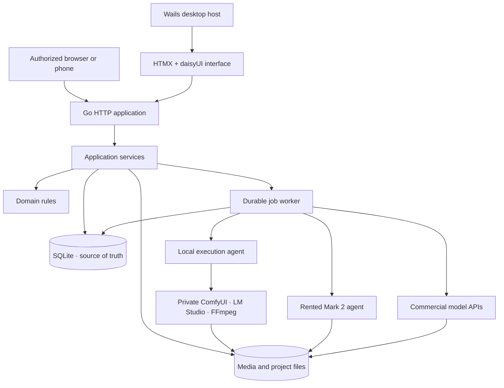
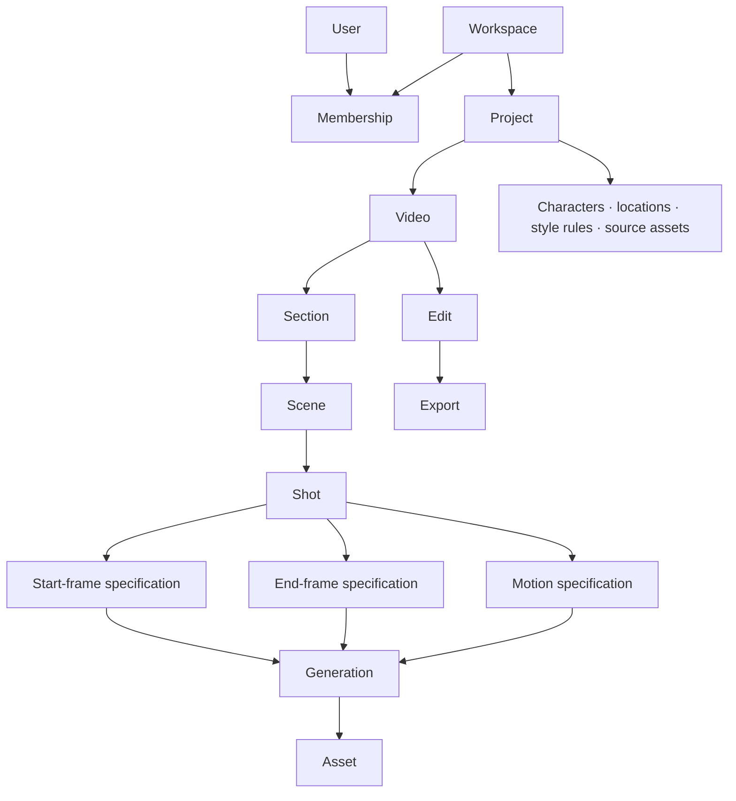
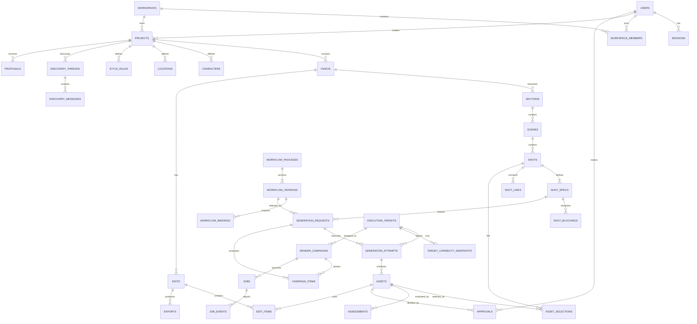
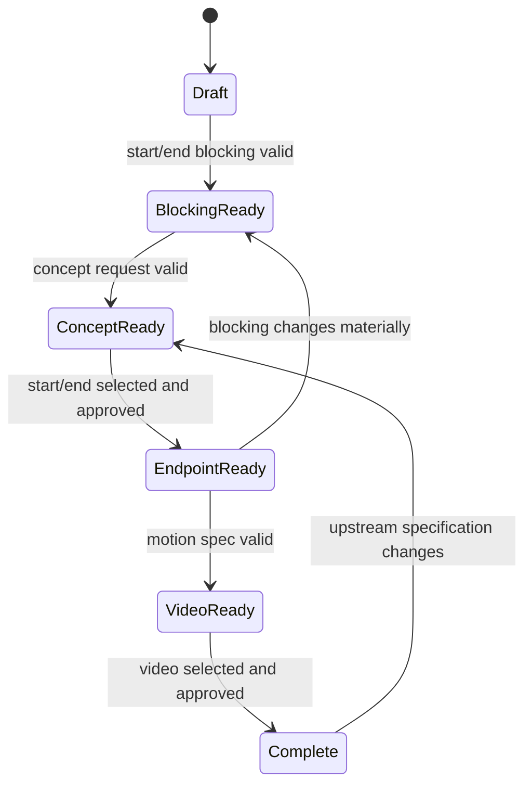
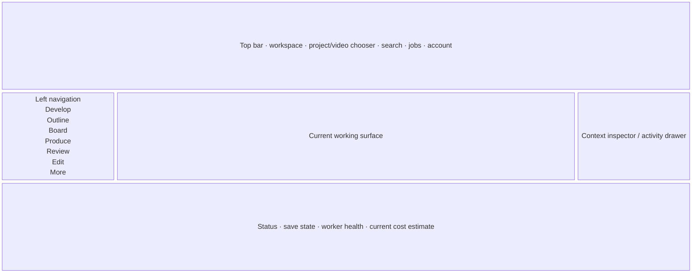
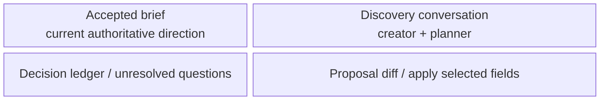
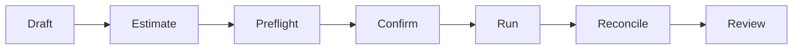
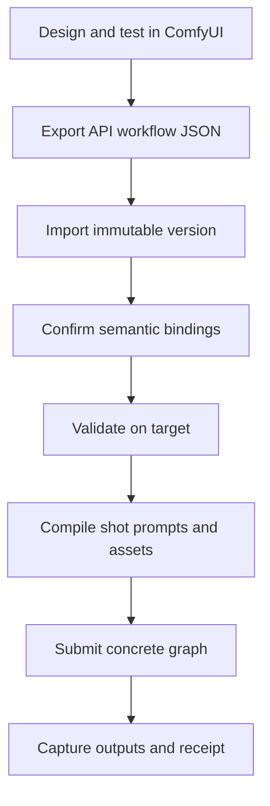

# Mark 2 Studio — Version 3.1 Complete Product and Application Specification

**Status:** Implementation specification  
**Version:** 3.1-draft-1  
**Primary stack:** Go, Wails, SQLite, server-rendered templ components, Chi, HTMX 2.x, daisyUI v5, minimal JavaScript islands  
**Primary deployment:** Wails desktop application containing a real local web application, with optional browser/LAN access, remote render agents and model APIs  
**Database decision:** SQLite is the sole source of truth

---

## 1. Executive decision

Mark 2 Version 3.1 is a local-first video development and production studio. It helps a creator develop an idea, construct a video, block its shots, generate assets, review alternatives, approve production decisions, assemble a finished edit, and decide where the required computation should run.

The central production model is:

> **A Project holds a shared creative world and production resources. A Video is one ordered deliverable. Outline, Storyboard and Edit are different views of that Video. Every Shot explicitly defines its beginning, destination and motion.**

Version 3.1 replaces the current demo-centred terminal workflow with an understandable desktop-first aprove to me that you can create a file
plication. Wails packages the product and supplies narrow operating-system integration, while the working interface remains a real HTTP/HTML application that can also run in a browser. Domain logic, HTTP handlers and templates must not depend on Wails.

### 1.1 Key deciions
you havew not creasetd anythign yet!!!
1. **SQLite remains the only database.** No PocketBase or SurrealDB dependency.
2. **Project and Video are distinct.** Creating a project automatically creates its first video.
3. **Users work through Workspaces.** One user may own personal work and participate in client workspaces without changing identity.
4. **The Storyboard is the visual centre of the application.** It must remain useful before expensive rendering begins.
5. **Blocking sketches are structured production artifacts.** An LLM produces a blocking specification; the browser renders deterministic SVG.
6. **First frame, last frame and motion are separate shot specifications.** The ending must express a visible change from the beginning.
7. **AI proposes; humans apply and approve.** Generated briefs, outlines, shots, assessments and compute recommendations do not silently become authoritative.
8. **Generation attempts are immutable history.** Rerendering creates new attempts and assets rather than overwriting old ones.
9. **Jobs and creative decisions are separate.** Successful execution does not mean the result is creatively acceptable.
10. **Remote computation is planned as a Render Campaign.** Local GPU, rented workers and APIs are execution targets for the same production requests.
11. **Wails is a host, not the architecture.** The same Chi/templ/HTMX application runs in the desktop window or an authorized browser.
12. **ComfyUI workflows are authored in ComfyUI.** Mark 2 imports, versions, binds, validates and executes API-format workflow graphs; it does not construct or edit node graphs in Go.
13. **Prompts remain first-class creative material.** Project, character, location, endpoint, motion, negative and workflow-specific layers remain visible, editable and versioned in Mark 2.
14. **ComfyUI is private infrastructure.** Local ComfyUI is reached through loopback by the desktop coordinator or local agent and is never exposed directly to the public internet.

## 2. Goals and non-goals

### 2.1 Version 3.1 goals

- Make one non-demo video travel from idea to exported multi-shot film without editing JSON.
- Make creative state, generation state and approval state visible and understandable.
- Support personal and client work using users, workspaces and membership roles.
- Produce a strong storyboard using blocking SVGs, concept frames and final frames.
- Preserve lineage from creative decision through workflow, model, generation and selected asset.
- Estimate render workload and group ready work into local, rented or API campaigns.
- Remain usable on the main workstation and useful from a phone or tablet.
- Install and launch as a normal desktop application while retaining an optional browser/server mode.
- Let creators import and bind their own tested ComfyUI API workflows without changing Go code.
- Route a frozen generation request to local ComfyUI, remote ComfyUI or a commercial API according to capabilities, privacy, cost and user choice.
- Keep the Go application authoritative and avoid a large client-side state system.
- Make every destructive or expensive operation explicit.

### 2.2 Version 3.1 non-goals

- Subscription billing, metering customers or public SaaS account management.
- A full nonlinear editor competitive with DaVinci Resolve or Premiere.
- Real-time multi-user co-editing.
- Fully autonomous “make my film” operation.
- Training or fine-tuning models.
- A generic node-graph editor.
- Constructing ComfyUI node graphs programmatically in application code.
- Exposing a raw ComfyUI endpoint over the internet.
- SurrealDB, PostgreSQL or distributed database support.
- Storing large media binaries inside SQLite.
- Audio generation in the first vertical slice; audio intent and later tracks are modelled.

## 3. Product mindset

### 3.1 The creator is a director, not a prompt operator

The interface should ask what a shot accomplishes, what the audience should notice, what visibly changes and what continuity must survive. Model names, samplers and LoRAs are production settings, not substitutes for creative direction.

### 3.2 Inspectability over automation theatre

The application must show:

- what the system proposes;
- which human accepted it;
- which specification was rendered;
- which model and workflow produced an asset;
- which asset was selected;
- why it was assessed or approved;
- which downstream work became stale after a change;
- what an external compute campaign is expected to cost.

### 3.3 Main path versus occasional work

| Main creative path | Occasional production/administrative path |
| --- | --- |
| Develop idea and brief | Manage users and workspace membership |
| Structure outline, scenes and shots | Configure models, providers and credentials |
| Block first and last frames | Calibrate performance estimates |
| Generate and compare candidates | Diagnose failed jobs |
| Approve frames and motion | Import/export project packages |
| Assemble and export video | Back up, restore or migrate the database |

The primary navigation must favour the left column. Occasional functions live under workspace settings, project settings or a production menu.

## 4. System architecture



### 4.1 Application layers

| Layer | Responsibility |
| --- | --- |
| Domain | State transitions, readiness rules, invalidation, permissions-independent production logic |
| Application services | Use cases, transactions, authorization calls, job creation, audit recording |
| Repositories | SQLite persistence and queries |
| HTTP | Request parsing, CSRF, permission gates, HTML/fragment selection, redirects |
| Templates | Complete pages and reusable HTML fragments |
| Worker | Claims durable jobs, invokes adapters, records events and observations |
| Adapters | LM Studio, ComfyUI, FFmpeg, remote workers and model APIs |
| Desktop host | Wails lifecycle, native menus, dialogs, notifications, file reveal and power-management integration |
| Local agent | Talks to private loopback services, stages media and reports capabilities without exposing ComfyUI |
| Media store | Atomic file placement, checksums, thumbnails and project-relative URIs |

### 4.2 Host modes and boundary rule

The same application supports four modes:

| Mode | Purpose | Network exposure |
| --- | --- | --- |
| `desktop` | Normal Wails installation on the production workstation | Loopback only by default |
| `local-web` | Development, testing or an additional browser window | Loopback only |
| `lan` | Paired phone/tablet storyboard and review | Explicitly enabled LAN listener |
| `server` | Future hosted/team coordinator | Deliberately deployed and fully authenticated |

The desktop executable starts the Go application and an HTTP listener on an available port. The Wails webview loads the same application served to a conventional browser. The listener uses an unpredictable port and a short-lived bootstrap token for its initial desktop session.

[Requirement: Domain, repository, application-service, HTTP-handler and templ packages must not import Wails packages. Wails integration lives behind a small `DesktopBridge` interface.]

[Recommendation: Essential production actions use HTTP routes. Wails bindings are optional capabilities such as directory selection, reveal-in-Explorer, native notification, external-open and preventing sleep.]

Each session receives a capability document rather than templates scattering `if desktop` checks:

```json
{
  "desktop": true,
  "native_file_dialogs": true,
  "reveal_file": true,
  "local_gpu": true,
  "lan_access": false
}
```

When LAN mode is enabled, the phone talks to Mark 2; Mark 2 talks to local ComfyUI. A phone or remote browser never receives direct ComfyUI credentials or filesystem paths.

### 4.3 HTMX decision

HTMX is the default interaction mechanism because most Version 3 actions are server-authoritative document transitions. The server returns HTML, not client-maintained JSON state. The current official HTMX documentation describes this hypermedia response model and supports partial targets, out-of-band swaps, request synchronization, polling and SSE-style extensions.

Use minimal JavaScript only when browser-local interaction is materially better:

1. **SVG blocking editor:** dragging actors, gaze targets, props and camera bounds before saving the resulting JSON specification.
2. **Timeline manipulation:** trimming, scrubbing and continuous drag positioning if the Edit screen eventually exceeds form-and-button interactions.
3. **Media playback:** browser video APIs and frame capture.
4. **Upload progress and global keyboard shortcuts.**

All JavaScript islands must serialize their state into ordinary forms and submit through authenticated application routes. They must not become alternate sources of truth.

### 4.4 daisyUI v5 and CDN policy

Version 3 development will use daisyUI v5 from a CDN as requested, together with Tailwind’s browser runtime where necessary:

```html
<link href="https://cdn.jsdelivr.net/npm/daisyui@5" rel="stylesheet" type="text/css">
<script src="https://cdn.jsdelivr.net/npm/@tailwindcss/browser@4"></script>
<script
  src="https://cdn.jsdelivr.net/npm/htmx.org@2.0.10/dist/htmx.min.js"
  integrity="sha384-H5SrcfygHmAuTDZphMHqBJLc3FhssKjG7w/CeCpFReSfwBWDTKpkzPP8c+cLsK+V"
  crossorigin="anonymous"></script>
```

Requirements:

- Pin HTMX to an exact tested release and retain its integrity hash.
- Pin daisyUI to the v5 major during active development; record the resolved release in the build receipt.
- Before a distributable or offline-first release, copy the tested static assets into the application and serve them from `/static/vendor/`.
- Templates must not change when moving from CDN to local assets.
- The app shell must display a clear error if required presentation assets fail to load; creative data remains accessible through semantic HTML.

[Decision: CDN use is acceptable during construction. Permanent CDN dependence conflicts with a local-first studio and is not a release requirement.]

The packaged Wails release must embed the tested HTMX JavaScript, generated daisyUI/Tailwind CSS, icons and fonts. It must remain usable without internet access.

## 5. Domain hierarchy and terminology



### 5.1 Definitions

| Term | Definition |
| --- | --- |
| User | An authenticated human identity; actions remain attributed to the real person |
| Workspace | Ownership and permission boundary for personal or client work |
| Project | Shared brief, creative world, references, characters, locations and production resources |
| Video | One intended deliverable, such as a 90-second promo or vertical cutdown |
| Section | Optional rhetorical/chapter structure in the outline |
| Scene | Dramatic, explanatory or location/time unit |
| Shot | Smallest visual production unit that begins in one state and ends in another |
| Shot specification | Human-editable definition of a start frame, end frame or motion |
| Blocking | Structured composition/pose/camera description rendered as deterministic SVG |
| Generation request | Desired output and candidate count frozen from a specification revision |
| Generation attempt | One immutable execution of a request on a particular target |
| Asset | Image, video, audio, document, mask, thumbnail, workflow or export stored outside SQLite |
| Selection | Decision that a particular asset currently fills a production role |
| Assessment | Evidence-based automated or human evaluation; advisory |
| Approval | Human decision accepting or rejecting an asset for production use |
| Edit | Ordered arrangement of selected clips, timing and transitions |
| Render campaign | Planned batch of compatible work assigned to an execution target |
| Execution target | Local worker, rented GPU configuration or model API |

## 6. SQLite design rules

1. Enable `PRAGMA foreign_keys = ON` on every connection.
2. Use WAL mode, a bounded busy timeout and short write transactions.
3. Use SQLite `STRICT` tables where practical.
4. Use UUIDv7-compatible lowercase text IDs as durable public identifiers.
5. Store timestamps as UTC RFC3339 text with millisecond precision.
6. Store durations as integer milliseconds or frame counts, never floating-point seconds.
7. Store monetary amounts as integer micros plus ISO currency code.
8. Store flexible specifications as validated JSON text with `CHECK(json_valid(...))`.
9. Store media outside SQLite; database rows contain relative URI, checksum, type and measured properties.
10. Every mutable aggregate has an integer `revision`; update commands require the expected revision.
11. User-facing deletion is soft deletion where recovery matters. Immutable attempts, approvals, audit events and usage observations are never silently rewritten.
12. Position fields are integers with transactional renumbering in Version 3. Fractional ordering is deferred until measured drag/reorder contention justifies it.

## 7. Entity-relationship diagram

The diagram shows the principal authoritative relationships. Supporting lookup, proposal, audit and annotation tables are described afterwards.



## 8. Data model catalogue

### 8.1 Identity and workspace

#### `users`

| Column | Type | Notes |
| --- | --- | --- |
| `id` | TEXT PK | UUIDv7 |
| `email_normalized` | TEXT UNIQUE | Case-normalized login identity |
| `display_name` | TEXT | Required |
| `password_hash` | TEXT | Argon2id or current approved password hash encoding |
| `status` | TEXT | `active`, `disabled` |
| `is_system_admin` | INTEGER | Boolean; exceptional administrative permission |
| `created_at`, `updated_at` | TEXT | UTC |

Public registration is not required initially. Users may be created by a system administrator. The schema remains compatible with later invitation or registration flows.

#### `sessions`

| Column | Type | Notes |
| --- | --- | --- |
| `id` | TEXT PK | Random session identifier; cookie contains opaque token |
| `user_id` | TEXT FK | Required |
| `token_hash` | BLOB UNIQUE | Never store raw session token |
| `csrf_secret` | BLOB | Per-session CSRF derivation material |
| `created_at`, `last_seen_at`, `expires_at` | TEXT | UTC |
| `revoked_at` | TEXT NULL | Revocation rather than deletion |
| `user_agent`, `ip_hint` | TEXT NULL | Diagnostic, minimize retention |

#### `workspaces`

`id`, `name`, `slug`, `kind` (`personal`, `client`, `team`), `created_by_user_id`, `created_at`, `updated_at`, `revision`, `archived_at`.

#### `workspace_members`

Composite uniqueness on `(workspace_id, user_id)`. Fields: `role` (`owner`, `editor`, `reviewer`, `viewer`), `status`, `joined_at`, `invited_by_user_id`.

Permission intent:

| Role | May do |
| --- | --- |
| Owner | Everything including membership, target configuration and deletion |
| Editor | Create and modify creative/production state, launch allowed campaigns |
| Reviewer | Comment, assess and approve/reject when assigned |
| Viewer | Read permitted project material and outputs |

### 8.2 Project and creative world

#### `projects`

`id`, `workspace_id`, `title`, `description`, `status` (`active`, `paused`, `completed`, `archived`), `created_by_user_id`, `created_at`, `updated_at`, `revision`, `archived_at`.

#### `project_briefs`

Versioned accepted creative direction. Fields: `id`, `project_id`, `version`, `premise`, `theme`, `audience`, `desired_reaction`, `pace`, `excitement`, `music_intent`, `sound_intent`, `visual_style`, `camera_language`, `production_notes`, `source_proposal_id`, `created_by_user_id`, `created_at`, `superseded_at`.

Only one non-superseded brief is current. A change creates a new version.

#### `characters`

`id`, `project_id`, `name`, `description`, `continuity_json`, `status`, `created_at`, `updated_at`, `revision`.

#### `locations`

`id`, `project_id`, `name`, `description`, `continuity_json`, `status`, timestamps and revision.

#### `style_rules`

`id`, `project_id`, `category`, `rule_text`, `priority`, `active`, `created_by_user_id`, timestamps and revision.

#### `source_materials`

Metadata for uploaded or linked documents, scripts, references and research. Fields: `id`, `project_id`, `kind`, `title`, `asset_id`, `source_uri`, `notes`, `created_by_user_id`, timestamps.

### 8.3 Discovery and proposals

#### `discovery_threads`

`id`, `project_id`, optional `video_id`, `title`, `status` (`open`, `closed`), `created_by_user_id`, timestamps.

#### `discovery_messages`

`id`, `thread_id`, `role` (`creator`, `planner`, `system`), `content`, optional `model_id`, `created_by_user_id`, `created_at`. Messages are append-only; corrections are new messages or explicit redactions.

#### `proposals`

Stores inspectable AI or human proposals before application.

`id`, `project_id`, optional `video_id`, `proposal_type`, `source_revision`, `payload_json`, `summary`, `status` (`proposed`, `partially_applied`, `applied`, `rejected`, `superseded`), `proposed_by_type`, optional `proposed_by_user_id`, optional `model_id`, `created_at`, `decided_at`, `decided_by_user_id`.

Supported initial proposal types: `project_brief`, `video_outline`, `scene_plan`, `shot_plan`, `blocking`, `prompt_revision`, `compute_plan`.

[Rule: Proposals never mutate authoritative project data until a human applies all or selected changes.]

### 8.4 Videos and structure

#### `videos`

`id`, `project_id`, `title`, `purpose`, `audience`, `desired_reaction`, `format` (`landscape`, `vertical`, `square`, custom), `width`, `height`, `fps_num`, `fps_den`, `target_duration_ms`, `status` (`developing`, `planning`, `producing`, `reviewing`, `editing`, `complete`, `archived`), `position`, `created_by_user_id`, timestamps, revision.

#### `sections`

`id`, `video_id`, optional `parent_section_id`, `title`, `purpose`, `summary`, `position`, `duration_budget_ms`, timestamps and revision. Every video receives one implicit root section; the UI may hide it for simple videos.

#### `scenes`

`id`, `section_id`, `title`, `synopsis`, `purpose`, `pace`, `audience_reaction`, `duration_budget_ms`, `position`, timestamps and revision.

#### `shots`

`id`, `scene_id`, `title`, `purpose`, `treatment`, `duration_target_ms`, `position`, `status`, `readiness`, `created_by_user_id`, timestamps and revision.

Shot status: `draft`, `blocked`, `ready`, `generating`, `review`, `approved`, `editing`, `complete`, `archived`.

Readiness is derived and cached: `incomplete`, `blocking_ready`, `concept_ready`, `endpoint_ready`, `video_ready`, `complete`. The service recomputes it after relevant changes.

#### `shot_specs`

Exactly one current specification per `(shot_id, kind)` where `kind` is `start_frame`, `end_frame` or `motion`.

Fields: `id`, `shot_id`, `kind`, `positive_prompt`, `negative_prompt`, `structured_spec_json`, `continuity_json`, `model_preferences_json`, `version`, `created_by_user_id`, `created_at`, `superseded_at`.

Editing creates a new specification version. Old versions remain available to generation receipts.

#### `shot_blockings`

`id`, `shot_spec_id`, `blocking_kind` (`start`, `end`), `version`, `spec_json`, optional `svg_cache_uri`, `source` (`human`, `model`, `mixed`), `created_by_user_id`, optional `model_id`, `created_at`, `superseded_at`.

Blocking JSON includes canvas, camera, zones, actors, pose, gaze, props, labels and motion arrows. Coordinates are normalized from `0.0` to `1.0`.

#### `shot_links`

`id`, `from_shot_id`, `to_shot_id`, `relation` (`continues_into`, `matches_action`, `same_moment`, `parallel_to`, `depends_on`), `metadata_json`, timestamps. Uniqueness on the relationship tuple.

### 8.5 Models, execution and generation

#### `workflow_packages`

Friendly logical workflows that Mark 2 offers to creators: `id`, `workspace_id` nullable for bundled packages, `name`, `slug`, `task`, `description`, `source` (`bundled`, `imported`), `active`, `created_by_user_id`, timestamps and revision.

A package is not a graph editor. It is the durable identity around immutable snapshots exported from ComfyUI in API format.

#### `workflow_versions`

Immutable imported workflow snapshots: `id`, `workflow_package_id`, `semantic_version`, `graph_json`, `graph_sha256`, `manifest_json`, `requirements_json`, `expected_outputs_json`, `tested_comfyui_version`, `status` (`draft`, `validated`, `retired`, `invalid`), `created_by_user_id`, `created_at`.

Importing an edited graph creates a new version. Existing attempts continue referencing the exact graph hash that produced them. Mark 2 never silently reloads a changed file from disk.

#### `workflow_bindings`

Maps Mark 2 concepts to editable inputs in one workflow version: `id`, `workflow_version_id`, `semantic_field`, `node_id`, `input_name`, `value_type`, `required`, `transform_json`, `default_json`, `created_at`.

Initial semantic fields include `first_frame_positive`, `first_frame_negative`, `last_frame_positive`, `last_frame_negative`, `motion_positive`, `motion_negative`, `first_frame_asset`, `last_frame_asset`, `reference_asset`, `seed`, `width`, `height`, `frame_count`, `fps`, `model_name`, `lora_stack` and `output_node`.

[Requirement: Import may suggest bindings by inspecting node types and field names, but a human must confirm them before a workflow version becomes `validated`.]

[Requirement: If a bound node or input disappears in a later graph, validation fails. Mark 2 must not guess a replacement during production.]

#### `models`

Catalog of logical and installed/remote models: `id`, `name`, `provider`, `family`, `task`, `version`, `quantization`, `requirements_json`, `capabilities_json`, `active`, timestamps.

#### `model_profiles`

Named reusable production settings: `id`, `workspace_id`, `name`, `task`, `model_id`, `settings_json`, `lora_stack_json`, `created_by_user_id`, timestamps and revision.

#### `execution_targets`

`id`, `workspace_id`, `name`, `kind` (`local_comfy`, `remote_agent`, `hosted_comfy`, `commercial_api`, `local_tool`), `capabilities_json`, `pricing_json`, `credential_ref`, `enabled`, `created_by_user_id`, timestamps and revision.

Credentials are stored using the operating system secret mechanism or environment configuration; `credential_ref` is not the secret.

`local_comfy` normally resolves to a loopback address and is never made publicly reachable by Mark 2.

#### `target_capability_snapshots`

Time-stamped preflight evidence: `id`, `execution_target_id`, `observed_at`, `service_version`, `node_types_json`, `models_json`, `capabilities_json`, `hardware_json`, `status`, `error_summary`. Compatibility is evaluated against a recent snapshot and rechecked immediately before execution.

#### `generation_requests`

Freezes desired work before execution: `id`, `project_id`, `video_id`, `shot_id`, `shot_spec_id`, `spec_version`, `workflow_version_id`, `output_role`, `quality_tier` (`blocking`, `concept`, `final`, `motion`, `enhance`), `candidate_count`, `model_profile_id`, `request_json`, `prompt_compilation_json`, `status`, `created_by_user_id`, timestamps and revision.

#### `generation_attempts`

One row per candidate execution: `id`, `generation_request_id`, optional `campaign_item_id`, `attempt_number`, `execution_target_id`, `model_id`, `workflow_version_id`, `workflow_graph_sha256`, `resolved_prompts_json`, `resolved_negative_prompts_json`, `bound_inputs_json`, `provider_request_receipt_json`, `seed`, `settings_json`, `status`, `queued_at`, `started_at`, `completed_at`, `error_code`, `error_message`, `cost_micros`, `currency`, `duration_ms`, `peak_vram_mb`.

Attempts are immutable except for their controlled state transition and measured completion fields.

#### `assets`

`id`, `workspace_id`, `project_id`, optional `generation_attempt_id`, `kind`, `role`, `storage_uri`, `mime_type`, `size_bytes`, `checksum_sha256`, optional `width`, `height`, `frame_count`, `duration_ms`, `metadata_json`, `created_at`, `deleted_at`.

Media files use project-relative storage URIs. File placement is atomic: temporary file, checksum, rename, then database commit.

#### `asset_selections`

`id`, `shot_id`, `role` (`start_frame`, `end_frame`, `video`, `thumbnail`), `asset_id`, `shot_revision`, `selected_by_user_id`, `selected_at`, `superseded_at`. Only one current selection per shot and role.

#### `asset_derivations`

`id`, `from_asset_id`, `to_asset_id`, `relation` (`reference`, `input`, `mask`, `upscaled_from`, `edited_from`, `thumbnail_of`), `metadata_json`.

### 8.6 Review, approval and collaboration

#### `assessments`

`id`, `asset_id`, `assessment_type`, `assessor_type` (`model`, `human`), optional `assessor_user_id`, optional `model_id`, `status` (`pass`, `review`, `fail`), `score`, `criteria_json`, `summary`, `created_at`.

Assessments are advisory evidence and never silently approve an asset.

#### `approvals`

`id`, `asset_id`, `scope`, `decision` (`approve`, `reject`, `approve_with_exception`), `reason`, `asset_checksum`, `shot_revision`, `user_id`, `created_at`. A new decision supersedes the effective prior decision but does not delete it.

#### `annotations`

`id`, `workspace_id`, `project_id`, optional `video_id`, optional `shot_id`, optional `asset_id`, optional `timecode_ms`, `body`, `status` (`open`, `resolved`), `created_by_user_id`, `assigned_to_user_id`, timestamps and revision.

### 8.7 Edit and export

#### `edits`

`id`, `video_id`, `name`, `status` (`draft`, `review`, `approved`, `exported`), `created_by_user_id`, timestamps and revision.

#### `edit_items`

`id`, `edit_id`, `shot_id`, `asset_id`, `position`, `source_in_ms`, `source_out_ms`, `duration_ms`, optional `transition_in_id`, optional `transition_out_id`, `settings_json`, timestamps and revision.

#### `transitions`

`id`, `edit_id`, `kind` (`cut`, `fade`, `dissolve`), `duration_ms`, `settings_json`.

#### `exports`

`id`, `edit_id`, `job_id`, `asset_id`, `profile_json`, `status`, `created_by_user_id`, timestamps, `error_message`.

### 8.8 Campaigns, jobs and observations

#### `render_campaigns`

`id`, `workspace_id`, `project_id`, optional `video_id`, `name`, `source_revision`, `execution_target_id`, `status` (`draft`, `estimated`, `ready`, `running`, `paused`, `completed`, `failed`, `cancelled`), `estimated_duration_ms`, `estimated_cost_micros`, `currency`, `actual_duration_ms`, `actual_cost_micros`, `created_by_user_id`, timestamps and revision.

#### `campaign_items`

`id`, `campaign_id`, `generation_request_id`, `position`, `priority`, `estimated_duration_ms`, `estimated_cost_micros`, `status`, timestamps.

#### `jobs`

`id`, `workspace_id`, optional `campaign_id`, `job_type`, `aggregate_type`, `aggregate_id`, `state` (`queued`, `claimed`, `running`, `succeeded`, `failed`, `cancel_requested`, `cancelled`), `priority`, `request_json`, `lease_owner`, `lease_expires_at`, `attempt_count`, `created_at`, `started_at`, `completed_at`, `error_code`, `error_message`.

#### `job_events`

`id`, `job_id`, `sequence`, `phase`, `level`, `message`, optional `progress_basis_points`, `data_json`, `created_at`. Unique `(job_id, sequence)`.

#### `execution_observations`

Measured evidence for estimates: `id`, `generation_attempt_id`, `execution_target_id`, `model_id`, `workflow_version_id`, `hardware_json`, `settings_fingerprint`, `elapsed_ms`, `startup_ms`, `peak_vram_mb`, `cost_micros`, `currency`, `success`, `created_at`.

### 8.9 Audit and domain events

#### `audit_events`

Append-only human/security audit: `id`, `workspace_id`, `actor_user_id`, `action`, `entity_type`, `entity_id`, `summary`, `metadata_json`, `created_at`.

#### `domain_events`

Transactional outbox for internal reactions: `id`, `workspace_id`, `aggregate_type`, `aggregate_id`, `event_type`, `payload_json`, `created_at`, `processed_at`, `processing_error`.

Initial events include `shot.spec_changed`, `asset.selected`, `asset.approved`, `generation.completed`, `campaign.completed` and `edit.changed`.

## 9. Required indexes and integrity rules

- Unique normalized user email.
- Unique workspace slug.
- Unique `(workspace_id, user_id)` membership.
- Index every foreign key used for lookup or cascade.
- Unique active brief version per project through a partial index on `superseded_at IS NULL`.
- Unique current shot specification per `(shot_id, kind)` through a partial index.
- Unique current asset selection per `(shot_id, role)` through a partial index.
- Unique current blocking per `(shot_spec_id, blocking_kind)` through a partial index.
- Unique job event sequence per job.
- Check constraints for enumerated states, positive durations, dimensions, frame counts, candidate counts and monetary values.
- Prevent a video, shot, asset or campaign from referencing a different workspace through service-level checks and integration tests.
- Prevent approval of a deleted asset or an asset whose checksum no longer matches.
- Prevent campaign launch if any item is not ready, target-incompatible or missing inputs.
- Project deletion archives by default; permanent deletion is an owner-only maintenance command with a preview of dependent media.

## 10. State and invalidation rules

### 10.1 Shot readiness



### 10.2 Exact invalidation

| Change | Becomes stale | Remains current |
| --- | --- | --- |
| Start-frame prompt/spec | Start candidates, video candidates using it | End frame if independent |
| End-frame prompt/spec | End candidates, video candidates using it | Start frame |
| Motion prompt/spec | Video candidates | Approved start/end frames |
| Blocking composition | Corresponding endpoint and downstream video | Other endpoint unless continuity rule says otherwise |
| Character continuity rule | Every derived asset that recorded that rule version | Unrelated shots |
| Model profile | Nothing automatically; new requests use new profile | Existing assets and receipts |
| Selected endpoint asset | Downstream video request/attempts | Source generations |

Assets are never deleted merely because they become stale. The UI displays stale lineage and offers regeneration.

### 10.3 Human authority

- A model assessment may recommend `pass`, `review` or `fail`.
- A human may approve despite model concern using `approve_with_exception` and a required reason.
- An expensive campaign requires a human launch action after estimate and preflight.
- Applying an AI proposal requires a human selection and confirmation.
- Export requires an approved or explicitly exception-approved edit.

## 11. HTTP and HTMX conventions

### 11.1 URL scope

Authoritative workspace routes begin with:

```text
/w/{workspaceID}/...
```

Project/video routes follow:

```text
/w/{workspaceID}/projects/{projectID}/videos/{videoID}/...
```

IDs are opaque. Slugs may appear in display URLs later but are not used for authorization.

### 11.2 Route semantics

- `GET` renders a full page or a fragment when `HX-Request: true`.
- `POST` performs creation or a named command.
- `PATCH` modifies an existing resource with `expected_revision`.
- `DELETE` requests deletion/archive and requires confirmation for meaningful loss.
- Every mutation validates CSRF, session, workspace membership and resource scope.
- Non-HTMX form submissions use Post/Redirect/Get.
- Successful HTMX mutations return the smallest coherent fragment plus optional out-of-band status/count updates.
- Validation errors return `422` and the form fragment with field errors.
- Revision conflicts return `409` and a conflict fragment offering reload, compare or copy-my-input.
- Permission failures return `403`; unauthenticated requests redirect to login for pages and return `401` for background fragments.
- Expensive commands return a queued job/campaign fragment immediately; they never hold an HTTP request open for generation.

### 11.3 Stable fragment IDs

Use durable DOM targets such as:

```text
#workspace-switcher
#project-summary
#video-outline
#storyboard
#shot-{shotID}
#shot-inspector
#blocking-canvas
#review-tray
#job-{jobID}
#campaign-summary
#toast-region
```

The server owns the complete markup for each target. Out-of-band swaps update navigation badges, readiness counts and toast messages after a primary mutation.

### 11.4 Accessibility and fallback

- Every HTMX operation must also work as an ordinary form or link when feasible.
- Buttons use real `<button>` elements; navigation uses real anchors.
- Drag/reorder has Move Up/Down and position form alternatives.
- SVG blocking elements have labels and an accompanying editable property table.
- Status is not communicated by colour alone.
- Dialogs use accessible focus management; destructive confirmation includes the target name.
- The application meets WCAG 2.2 AA for primary workflows.

## 12. Route catalogue

Each route entry identifies the server responsibility, system requirement and human activity. “Human activity” is not incidental: it defines what judgment remains with the creator or reviewer.

### 12.1 Session and account routes

| Method and route | Responsibility | Requirements | Human activity / mindset | Response |
| --- | --- | --- | --- | --- |
| `GET /login` | Render login form | Anonymous session | Identify yourself; no project state is changed | Full page |
| `POST /login` | Verify credentials, rotate session, set secure cookie | Rate limit; valid CSRF bootstrap; active user | Enter credentials; respond to clear failure without account enumeration | Redirect to last workspace or workspace chooser |
| `POST /logout` | Revoke current session | Authenticated session | Explicitly end access on this browser | Redirect to login |
| `GET /account` | Show profile and active sessions | Authenticated | Review identity and access | Full/fragment |
| `PATCH /account/profile` | Update display name | Authenticated; expected revision | Confirm how authored activity will be labelled | Profile fragment |
| `GET /account/sessions` | List active/recent sessions | Authenticated | Revoke devices that should no longer have access | Fragment |
| `DELETE /account/sessions/{sessionID}` | Revoke session | Own session or system admin | Confirm revocation | Session list fragment |

Public registration is deferred. An administrative CLI or owner-only screen creates initial accounts. Later routes may add invitations without changing ownership tables.

### 12.2 Workspace and membership routes

| Method and route | Responsibility | Requirements | Human activity / mindset | Response |
| --- | --- | --- | --- | --- |
| `GET /workspaces` | List accessible workspaces | Authenticated | Choose whose body of work you are entering | Full page |
| `POST /workspaces` | Create personal/client/team workspace | Authenticated | Name ownership boundary correctly | New workspace redirect |
| `GET /w/{w}` | Workspace dashboard | Member | Review active projects, production load and blocked work | Full page |
| `GET /w/{w}/switcher` | Render workspace switcher | Member | Switch context without changing identity | Popover fragment |
| `GET /w/{w}/settings` | Workspace settings | Owner | Treat settings as occasional administration | Full page |
| `PATCH /w/{w}` | Update name/kind | Owner; expected revision | Confirm ownership label | Header/settings fragments |
| `GET /w/{w}/members` | List memberships | Owner | Review who can see or change client work | Full/fragment |
| `POST /w/{w}/members` | Add existing user or pending invitation | Owner | Select real person and least-privilege role | Member row + toast |
| `PATCH /w/{w}/members/{userID}` | Change role/status | Owner; cannot remove last owner | Understand effect on access and approvals | Member row |
| `DELETE /w/{w}/members/{userID}` | Remove access | Owner; confirmation | Confirm removal and outstanding assigned reviews | Updated list |

### 12.3 Project routes

| Method and route | Responsibility | Requirements | Human activity / mindset | Response |
| --- | --- | --- | --- | --- |
| `GET /w/{w}/projects` | List/search/filter projects | Member | Find work by client, state or blocked status | Full page or grid fragment |
| `GET /w/{w}/projects/new` | New-project form | Editor+ | Decide whether this is a new creative world or another video in an existing project | Modal/page |
| `POST /w/{w}/projects` | Create project, default video, root section and draft edit transactionally | Editor+ | Supply title, purpose and initial video format | Redirect to Develop |
| `GET /w/{w}/projects/{p}` | Project dashboard | Member; scoped project | Review brief, videos, people/places, readiness and cost forecast | Full page |
| `GET /w/{w}/projects/{p}/settings` | Project settings | Editor+ | Occasional metadata, storage and archive management | Full page |
| `PATCH /w/{w}/projects/{p}` | Update metadata/status | Editor+; expected revision | Confirm project-level change | Summary fragment |
| `POST /w/{w}/projects/{p}/archive` | Archive project | Owner/editor with policy | Confirm project disappears from active work but remains recoverable | Redirect/list update |
| `POST /w/{w}/projects/{p}/restore` | Restore archived project | Owner/editor | Confirm restoration | Redirect |
| `GET /w/{w}/projects/{p}/package` | Preview portable export contents | Owner/editor | Check private/source materials before packaging | Preview page |
| `POST /w/{w}/projects/{p}/package` | Queue portable project package | Owner/editor | Explicitly initiate export | Job fragment |

### 12.4 Video and outline routes

| Method and route | Responsibility | Requirements | Human activity / mindset | Response |
| --- | --- | --- | --- | --- |
| `POST /w/{w}/projects/{p}/videos` | Create another deliverable | Editor+ | Decide whether a cutdown/variant deserves independent structure | Redirect to video Develop |
| `GET .../videos/{v}` | Video overview | Member | See current phase, blockers, duration and selected edit | Full page |
| `PATCH .../videos/{v}` | Update video purpose/format/target | Editor+; expected revision | Make format and audience intent explicit | Header/summary fragments |
| `GET .../videos/{v}/outline` | Render hierarchical contents | Member | Judge narrative order before visual detail | Full page |
| `POST .../videos/{v}/sections` | Add section | Editor+ | State what this division accomplishes | Section fragment |
| `PATCH .../sections/{sectionID}` | Edit section | Editor+; expected revision | Refine purpose, title and duration budget | Section fragment |
| `POST .../sections/{sectionID}/move` | Reorder section | Editor+ | Confirm rhetorical order | Outline fragment |
| `DELETE .../sections/{sectionID}` | Archive/delete empty section or rehome descendants | Editor+; confirmation | Choose disposition of scenes; never silently delete children | Outline fragment or decision dialog |
| `POST .../sections/{sectionID}/scenes` | Add scene | Editor+ | Define dramatic/explanatory unit | Scene fragment |
| `PATCH .../scenes/{sceneID}` | Edit scene | Editor+; expected revision | Define purpose, reaction, pace and budget | Scene fragment |
| `POST .../scenes/{sceneID}/move` | Reorder/move scene | Editor+ | Preserve intended narrative progression | Outline + board OOB fragments |
| `DELETE .../scenes/{sceneID}` | Archive scene | Editor+; confirmation | Review affected shots/assets before removal | Decision/outline fragment |

### 12.5 Discovery, brief and proposal routes

| Method and route | Responsibility | Requirements | Human activity / mindset | Response |
| --- | --- | --- | --- | --- |
| `GET .../videos/{v}/develop` | Unified Discovery and accepted brief screen | Member | Work from ambiguity toward explicit decisions | Full page |
| `POST .../discovery/threads` | Create thread | Editor+ | Name the question being explored | Thread fragment |
| `POST .../discovery/threads/{threadID}/messages` | Append creator message | Editor+ | Record decisions, constraints or questions | Message + planner controls |
| `POST .../discovery/threads/{threadID}/ask` | Queue planner reply | Editor+; planner target configured | Ask for useful reflection; do not expect silent plan mutation | Job/message placeholder |
| `POST .../proposals/brief` | Queue structured brief proposal from selected conversation/context | Editor+ | Select authoritative source material and intent | Proposal placeholder |
| `GET .../proposals/{proposalID}` | Show proposal diff | Member | Compare proposed facts against accepted state | Full/modal fragment |
| `POST .../proposals/{proposalID}/apply` | Apply all or selected proposal fields transactionally | Editor+; expected source revision | Select fields consciously; resolve conflicts | Updated brief/outline + proposal state |
| `POST .../proposals/{proposalID}/reject` | Reject with optional reason | Editor+ | Record why suggestion was unsuitable | Proposal fragment |
| `GET .../brief/history` | Show accepted brief versions | Member | Understand how direction changed | Drawer/page |
| `POST .../brief/revise` | Create manual brief revision | Editor+; expected project revision | Make project-wide creative change knowingly | Brief fragment and invalidation preview |

### 12.6 Storyboard and shot routes

| Method and route | Responsibility | Requirements | Human activity / mindset | Response |
| --- | --- | --- | --- | --- |
| `GET .../videos/{v}/board` | Render storyboard grouped by section/scene | Member | See the film before rendering; find incomplete or contradictory shots | Full page |
| `GET .../board/filter` | Filter by readiness/status/character/location | Member | Focus on a workable subset | Board grid fragment; `hx-push-url` |
| `POST .../scenes/{sceneID}/shots` | Create shot and three initial specs | Editor+ | State the shot’s purpose and visible change | Shot card + inspector |
| `GET .../shots/{shotID}` | Shot detail/inspector | Member | Examine purpose, endpoints, motion, continuity and history | Drawer/full page |
| `PATCH .../shots/{shotID}` | Edit shot metadata | Editor+; expected revision | Clarify purpose/treatment/duration | Card + inspector + readiness badge |
| `POST .../shots/{shotID}/move` | Reorder/move shot | Editor+ | Preserve continuity and edit order | Affected scenes OOB |
| `POST .../shots/{shotID}/duplicate` | Duplicate structure/specs without attempts | Editor+ | Confirm what creative material carries forward | New shot card |
| `POST .../shots/{shotID}/archive` | Archive shot | Editor+; confirmation | Review selected assets/edit usage first | Board update |
| `GET .../shots/{shotID}/history` | Show revisions, generations and decisions | Member | Understand lineage; compare without overwriting | Full/drawer |

### 12.7 Shot specification and blocking routes

| Method and route | Responsibility | Requirements | Human activity / mindset | Response |
| --- | --- | --- | --- | --- |
| `GET .../shots/{shotID}/specs/{kind}` | Render spec editor | Member | Inspect positive, negative, structured and continuity instructions | Inspector tab |
| `PATCH .../shots/{shotID}/specs/{kind}` | Create new spec version and calculate invalidation | Editor+; expected shot/spec version | Review affected outputs before saving | Spec + invalidation summary OOB |
| `POST .../shots/{shotID}/specs/{kind}/suggest` | Queue prompt/spec suggestion | Editor+ | Request an alternative, not an automatic overwrite | Proposal placeholder |
| `GET .../shots/{shotID}/blocking` | Open paired start/end blocking editor | Member | Compare beginning and destination as one visual problem | Full page/modal |
| `POST .../shots/{shotID}/blocking/suggest` | Queue structured blocking proposal | Editor+; valid shot purpose/specs | Tell system which endpoint(s) need blocking | Proposal placeholder |
| `PATCH .../shots/{shotID}/blocking/{role}` | Save new human/mixed blocking version | Editor+; expected blocking/spec version | Arrange actors, gaze, props and camera; verify continuity | Canvas + readiness + card thumbnail |
| `POST .../shots/{shotID}/blocking/{role}/copy` | Copy opposite or prior blocking as starting point | Editor+ | Intentionally preserve continuity, then change what the shot accomplishes | Blocking editor fragment |
| `POST .../shots/{shotID}/blocking/compare` | Evaluate visible changes and contradictions | Editor+ | Review detected change; accept, correct or explain exception | Change-analysis panel |

### 12.8 Generation and production routes

Workflow management is occasional production configuration, not part of the normal shot path:

| Method and route | Responsibility | Requirements | Human activity / mindset | Response |
| --- | --- | --- | --- | --- |
| `GET /w/{w}/workflows` | List bundled and imported workflow packages and validation state | Member | Visit only when adding, revising or diagnosing execution methods | Full page |
| `POST /w/{w}/workflows/import` | Import ComfyUI API-format JSON as an immutable draft version | Owner/editor; valid JSON; size limit | Select a workflow already proven in ComfyUI | Import review page |
| `GET /w/{w}/workflow-versions/{versionID}/bindings` | Inspect nodes, suggested semantic inputs, requirements and outputs | Owner/editor | Understand which controls Mark 2 may safely change | Full page |
| `PATCH /w/{w}/workflow-versions/{versionID}/bindings` | Confirm binding mappings and transformations | Owner/editor; expected revision | Verify every important prompt, image and output mapping | Binding table fragment |
| `POST /w/{w}/workflow-versions/{versionID}/validate` | Validate graph, bindings and selected target capability | Owner/editor; target selected | Treat validation as evidence, not proof of visual quality | Validation report |
| `POST /w/{w}/workflow-versions/{versionID}/test-run` | Run bounded test inputs and capture outputs/receipt | Owner/editor; validation passes | Visually confirm the workflow before offering it in production | Test job page |
| `POST /w/{w}/workflow-versions/{versionID}/activate` | Make validated version selectable | Owner; successful test or recorded exception | Accept responsibility for production use | Workflow status fragment |
| `POST /w/{w}/workflow-versions/{versionID}/retire` | Prevent new requests while preserving history | Owner | Retire broken/outdated versions without damaging receipts | Workflow status fragment |

Desktop and local-agent routes:

| Method and route | Responsibility | Requirements | Human activity / mindset | Response |
| --- | --- | --- | --- | --- |
| `GET /app/capabilities` | Return session/host capability document | Authenticated session | None | JSON used only for progressive enhancement |
| `POST /app/native/select-directory` | Invoke desktop directory chooser | Desktop capability and CSRF | Choose a directory intentionally | Selected path fragment/JSON bridge result |
| `POST /app/native/reveal` | Reveal an authorized project asset in the OS | Desktop capability; scoped asset ID | Confirm correct asset rather than entering an arbitrary path | No-content/toast |
| `GET /settings/local-services` | Configure and test local ComfyUI/LM Studio/FFmpeg | Owner/editor; desktop/local host | Occasional machine setup | Full page |
| `POST /settings/local-services/comfyui/test` | Probe loopback ComfyUI and capture capability snapshot | Owner/editor; loopback allowlist | Confirm service and installed nodes/models | Test results fragment |
| `POST /settings/lan/enable` | Start paired LAN access | Owner; desktop confirmation | Deliberately open access for a bounded period/device | QR/pairing page |
| `POST /settings/lan/disable` | Revoke LAN listener/pairings | Owner | Close access when no longer needed | Status fragment |

| Method and route | Responsibility | Requirements | Human activity / mindset | Response |
| --- | --- | --- | --- | --- |
| `GET .../videos/{v}/produce` | Production queue and readiness screen | Member | Convert ready creative work into controlled generation requests | Full page |
| `GET .../shots/{shotID}/generate/{role}` | Render request form and estimate | Editor+ | Choose quality tier, candidates and profile; avoid needless final renders | Modal/page |
| `GET .../shots/{shotID}/prompt-workbench` | Edit layered start/end/motion prompts and negatives | Member | Describe purpose, endpoint states and motion without editing the graph | Full page/drawer |
| `POST .../shots/{shotID}/prompt-preview` | Compile inherited prompt layers without saving or executing | Editor+ | Inspect exactly what each workflow will receive | Compiled prompt fragment |
| `POST .../shots/{shotID}/prompt-variants` | Save a named prompt variant | Editor+; expected spec revision | Preserve an experiment rather than overwriting the current idea | Variant row |
| `POST .../shots/{shotID}/generation-requests` | Freeze spec revision and create request | Editor+; readiness satisfied | Confirm candidate count and intended output role | Request row/card |
| `PATCH .../generation-requests/{requestID}` | Modify unexecuted request | Editor+; expected revision; no attempts started | Adjust plan before cost is incurred | Request fragment |
| `POST .../generation-requests/{requestID}/run-local` | Queue on permitted local target | Editor+; preflight passes | Explicitly consume local resources | Job/request status fragments |
| `POST .../generation-requests/{requestID}/add-to-campaign` | Add request to draft campaign | Editor+; compatibility check | Group work intentionally | Campaign badge + request fragment |
| `POST .../generation-attempts/{attemptID}/retry` | Create a new attempt using same frozen inputs | Editor+ | Decide whether failure was transient; do not overwrite evidence | New attempt row |
| `POST .../jobs/{jobID}/cancel` | Request cooperative cancellation | Editor+ | Understand partial outputs may remain as unselected evidence | Job fragment |
| `GET .../jobs/{jobID}` | Show job phases, logs and outputs | Member | Diagnose current work without reading console output | Drawer/page |
| `GET .../jobs/{jobID}/status` | Poll/SSE fragment | Member | No judgment required; observe progress | Status fragment |

### 12.9 Asset selection, review and approval routes

| Method and route | Responsibility | Requirements | Human activity / mindset | Response |
| --- | --- | --- | --- | --- |
| `GET .../videos/{v}/review` | Review inbox grouped by shot/role | Member | Compare candidates against purpose, continuity and endpoint change | Full page |
| `GET .../shots/{shotID}/candidates/{role}` | Candidate comparison | Member | Compare full-size assets and receipts; avoid choosing from thumbnails alone | Page/modal |
| `POST .../shots/{shotID}/selections` | Select asset for role, recalculate downstream staleness | Editor+ or assigned reviewer; checksum valid | Choose the best current production evidence | Board/review OOB fragments |
| `POST .../assets/{assetID}/assess` | Queue model assessment | Editor+ | Select criteria/model; assessment remains advice | Assessment placeholder |
| `POST .../assets/{assetID}/assessments` | Record human assessment | Reviewer+ | Evaluate named criteria and write useful evidence | Assessment fragment |
| `POST .../assets/{assetID}/approvals` | Approve, reject or approve with exception | Reviewer+; selected or explicitly scoped asset | Make accountable production decision; reason required for exception/rejection | Approval, shot state and review-count fragments |
| `POST .../annotations` | Add timecode/asset/shot annotation | Reviewer+ | State actionable observation, not vague dislike | Annotation fragment |
| `PATCH .../annotations/{annotationID}` | Resolve/reassign annotation | Assigned user/editor+ | Confirm issue is addressed or intentionally closed | Annotation fragment |

### 12.10 Edit and export routes

| Method and route | Responsibility | Requirements | Human activity / mindset | Response |
| --- | --- | --- | --- | --- |
| `GET .../videos/{v}/edit` | Render edit/timeline view | Member | Judge sequence, rhythm and total duration | Full page |
| `POST .../videos/{v}/edits` | Create alternate edit | Editor+ | Name editorial purpose | Redirect to edit |
| `PATCH .../edits/{editID}` | Update edit metadata/status | Editor+; expected revision | Mark review/approval deliberately | Header fragment |
| `POST .../edits/{editID}/items` | Add approved/exception-approved clip | Editor+ | Choose source clip and trim | Timeline fragment |
| `PATCH .../edit-items/{itemID}` | Change trim/duration/transition refs | Editor+; expected revision | Make editorial decision and preview effect | Item + totals OOB |
| `POST .../edit-items/{itemID}/move` | Reorder item | Editor+ | Judge narrative/rhythmic order | Timeline fragment |
| `DELETE .../edit-items/{itemID}` | Remove from edit, not delete asset | Editor+ | Confirm removal from this cut only | Timeline fragment |
| `POST .../edits/{editID}/validate` | Check missing assets, codecs, durations and mixed transitions | Editor+ | Review warnings before export | Validation panel |
| `GET .../edits/{editID}/export` | Export profile form and estimate | Editor+ | Choose format, resolution and destination | Modal/page |
| `POST .../edits/{editID}/exports` | Queue FFmpeg export | Editor+; validation passes | Explicitly initiate final assembly | Export job fragment |
| `GET .../exports/{exportID}` | Show receipt, output and errors | Member | Inspect/play/download final output | Page/drawer |

### 12.11 Compute planner and campaign routes

| Method and route | Responsibility | Requirements | Human activity / mindset | Response |
| --- | --- | --- | --- | --- |
| `GET /w/{w}/compute` | Workspace-wide ready-work and target dashboard | Member | See whether sufficient work exists to justify rental/API spend | Full page |
| `GET .../videos/{v}/compute` | Video-scoped workload forecast | Member | Compare local time against external options | Full page/fragment |
| `POST .../compute/estimate` | Estimate selected requests across eligible targets | Editor+ | Select honest candidate volume and contingency | Estimate comparison fragment |
| `POST .../campaigns` | Create draft campaign from selected requests | Editor+ | Define bounded production event | Campaign builder redirect |
| `GET .../campaigns/{campaignID}` | Campaign plan/readiness/actuals | Member | Review compatibility, missing inputs and economics | Full page |
| `PATCH .../campaigns/{campaignID}` | Edit target/name/items while draft | Editor+; expected revision | Balance throughput, cost and operational risk | Summary/items fragments |
| `POST .../campaigns/{campaignID}/preflight` | Verify target, models, assets, capacity, credentials and package | Editor+ | Resolve every blocking error before rental | Preflight results |
| `POST .../campaigns/{campaignID}/launch` | Freeze campaign and create jobs | Owner/editor with spend permission; confirmation; preflight current | Accept estimated spend and launch | Running campaign page |
| `POST .../campaigns/{campaignID}/pause` | Stop claiming new items | Editor+ | Preserve running work; decide whether to resume | Campaign controls |
| `POST .../campaigns/{campaignID}/cancel` | Request cancellation | Owner/editor; confirmation | Understand provider charges and partial outputs | Campaign controls/status |
| `POST .../campaigns/{campaignID}/reconcile` | Fetch/enter provider usage and actual cost | Owner/editor | Verify charges rather than trusting estimate | Actuals fragment |
| `GET /w/{w}/execution-targets` | List targets and measured performance | Owner/editor | Occasional production configuration | Full page |
| `POST /w/{w}/execution-targets` | Create target metadata | Owner | Describe capacity/pricing without storing raw secret | Target row |
| `PATCH /w/{w}/execution-targets/{targetID}` | Update capabilities/pricing/enabled | Owner; expected revision | Keep assumptions current | Target row |
| `POST /w/{w}/execution-targets/{targetID}/test` | Queue connectivity/capability test | Owner | Confirm target before trusting production work | Test job fragment |

### 12.12 Character, location, style and continuity routes

| Method and route | Responsibility | Requirements | Human activity / mindset | Response |
| --- | --- | --- | --- | --- |
| `GET .../projects/{p}/bible` | Project world/reference overview | Member | Maintain consistency across videos | Full page |
| `POST .../characters` / `locations` / `style-rules` | Create reusable project entities | Editor+ | Record rules that truly need continuity | Card/list fragment |
| `PATCH .../{entity}/{id}` | Revise entity and preview affected shots/assets | Editor+; expected revision | Decide whether change invalidates existing work | Diff/invalidation confirmation |
| `GET .../{entity}/{id}/usage` | Show shots/specs/assets depending on entity | Member | Understand consequences before changing | Drawer/page |
| `POST .../shots/{shotID}/continuity` | Attach character/location/style rule versions | Editor+ | Select only relevant constraints | Continuity panel |

### 12.13 Administration and diagnostics routes

| Method and route | Responsibility | Requirements | Human activity / mindset | Response |
| --- | --- | --- | --- | --- |
| `GET /admin/users` | User administration | System admin | Create/disable accounts carefully | Full page |
| `POST /admin/users` | Create initial/invited user | System admin | Verify identity and initial access | User row |
| `PATCH /admin/users/{userID}` | Disable/enable user | System admin | Review memberships and active sessions | User row |
| `GET /w/{w}/diagnostics` | Database/media/worker/adapter health | Owner/editor | Occasional diagnosis; not creative workflow | Full page |
| `POST /w/{w}/diagnostics/preflight` | Queue comprehensive environment check | Owner/editor | Run before a major campaign or after configuration change | Job results |
| `GET /healthz` | Process liveness | Local/operator access | None | Minimal status |
| `GET /readyz` | DB, migrations and worker readiness | Local/operator access | None | Minimal status |

## 13. Application navigation

### 13.1 Global shell

The Wails window and browser presentation use the same responsive application shell. It has four persistent regions:



The right inspector is contextual and collapsible. On narrower displays it becomes a daisyUI drawer. The status strip must never be the only place errors appear.

### 13.2 Primary navigation order

1. **Develop** — Discovery, accepted brief and proposals.
2. **Outline** — Sections, scenes and shot list without production detail.
3. **Board** — Visual shot cards, blocking and generated endpoints.
4. **Produce** — Ready work, generation requests and active jobs.
5. **Review** — Candidate comparison, assessments, approvals and annotations.
6. **Edit** — Selected clips, ordering, timing, transitions and export.
7. **More** — Project Bible, Compute Planner, settings, diagnostics and history.

The sequence expresses increasing commitment. Users may move freely, but the UI displays readiness rather than pretending later stages are complete.

### 13.3 Workspace and project context

- Workspace switcher is always visible in the top bar.
- Project/video chooser shows the current hierarchy and permits quick switching.
- Breadcrumbs are used inside deep forms: `Project / Video / Scene / Shot`.
- Switching workspace returns to that workspace’s last visited safe page; it never reuses an unauthorized URL.
- Client workspaces have a visually distinct badge to reduce accidental cross-client actions.

### 13.4 Mobile navigation

Mobile uses a bottom navigation with `Develop`, `Board`, `Produce`, `Review`, and `More`. Outline is accessible through Develop; Edit is accessible through More until a tablet/desktop width is available. The mobile experience prioritizes:

- reviewing and refining intent;
- rearranging outline items using buttons;
- editing blocking properties;
- approving/rejecting outputs;
- monitoring jobs and campaigns.

High-resolution timeline work and dense multi-candidate comparison may recommend a larger screen but must remain readable.

### 13.5 Keyboard navigation

Keyboard shortcuts apply only when focus is not in an editable control:

| Shortcut | Action |
| --- | --- |
| `g d` | Develop |
| `g o` | Outline |
| `g b` | Board |
| `g p` | Produce |
| `g r` | Review |
| `g e` | Edit |
| `j` / `k` | Next / previous shot card |
| `Enter` | Open selected shot inspector |
| `Esc` | Close inspector/modal; never discard unsaved text without warning |
| `/` | Search |
| `?` | Shortcut help |

There is no global shortcut that launches a render or replaces project data.

## 14. Screen and form specifications

### 14.1 Login

**Purpose:** Establish identity with minimal distraction.

**Layout:** Centred daisyUI card containing email, password, show-password control, submit button and generic error region.

**Human responsibility:** Use the correct personal identity even when entering a client workspace.

**Requirements:** Secure cookie, rate limiting, CSRF bootstrap, accessible labels, password-manager compatibility.

### 14.2 Workspace dashboard

**Purpose:** Answer “What needs attention across this body of work?”

**Regions:**

- active projects;
- assigned reviews;
- running/failed jobs;
- ready external-compute workload;
- recently changed assets;
- create-project action.

**Mindset:** Portfolio overview, not project editing.

### 14.3 New project form

Fields:

| Field | Requirement |
| --- | --- |
| Project title | Required; workspace-meaningful |
| Project description | Optional |
| First video title | Defaults to project title |
| Video purpose | Required; short statement |
| Audience | Optional initially, highlighted as incomplete |
| Format | Landscape, vertical, square or custom |
| Target duration | Optional, milliseconds derived from human input |

Submission creates project, video, implicit root section, discovery thread and draft edit in one transaction.

### 14.4 Project dashboard

**Purpose:** Show project-wide direction and resources.

**Layout:** Brief summary across top; videos as cards; below that Characters, Locations, Style Rules and Source Materials; right column displays unresolved proposals and production health.

**Primary actions:** Continue current video, create related video, revise brief, add project reference.

**Human responsibility:** Decide whether new work belongs in this shared creative world or deserves a separate project.

### 14.5 Develop screen



**Purpose:** Convert ambiguity into accepted direction without hiding how decisions emerged.

**Forms and actions:**

- creator message composer;
- planner model/target chooser under an advanced disclosure;
- “Ask planner”;
- “Propose brief”;
- accepted brief editor;
- proposal diff with individual field checkboxes;
- decision note and unresolved-question controls.

**HTMX behaviour:** New messages append to the conversation. Planner job inserts a waiting message and polls or subscribes until replaced. Applying a proposal updates brief, proposal status and any affected readiness notices out of band.

**Human responsibility:** Distinguish discussion from decision. Apply only claims and direction actually accepted.

### 14.6 Outline screen

**Purpose:** Shape what the video says before deciding how every moment looks.

**Layout:** Nested sections and scenes in the main column; duration budget and narrative diagnostics in the right inspector.

Each row displays title, purpose, target reaction, duration budget, number of shots and readiness. Expand/collapse is preserved in the URL or session preference.

**Primary actions:** Add section, add scene, reorder, request outline proposal, apply selected proposal items.

**Human responsibility:** Ensure every section earns its place and the total duration is plausible.

**HTMX behaviour:** Reorder returns the affected parent list. Duration totals update out of band. Dragging is optional enhancement; move buttons are canonical.

### 14.7 Storyboard screen

**Purpose:** Let the creator see the planned film before expensive pixels exist.

**Default card anatomy:**

```mermaid
block-beta
  columns 6
  head["Shot title · purpose · duration · readiness"]:6
  start["START\nblocking / concept / final"]:2
  change["CHANGE\nmotion · camera · continuity warnings"]:2
  end["END\nblocking / concept / final"]:2
  state["selected assets · approvals · stale indicators · actions"]:6
```

Board display modes:

- **Compact:** one card per shot with small endpoint thumbnails.
- **Director:** large start/change/end cards.
- **Continuity:** emphasizes shot-to-shot links, characters, costume, props and location.
- **Production:** emphasizes readiness, generation count, estimates and failures.

Filters: status, readiness, section, scene, character, location, missing endpoint, stale output, assigned reviewer.

**Primary actions:** Open shot, add shot, generate blocking, compare change, request concept frames, send ready shots to Produce.

**Human responsibility:** Confirm that each shot has a purpose and that the end state differs meaningfully from the start.

### 14.8 Shot inspector

The inspector uses tabs:

1. **Intent** — purpose, treatment, intended reaction, duration.
2. **Start** — prompt, structured spec, continuity, current selection.
3. **End** — prompt, structured spec, continuity, current selection.
4. **Motion** — subject/camera/environment motion, negative motion, duration.
5. **Continuity** — attached character/location/style versions and neighbouring shots.
6. **History** — proposals, spec versions, attempts, selections and decisions.

Every save shows an invalidation preview before creating a new version when approved or generated descendants exist.

**Human responsibility:** Edit intent rather than compensating for a model with contradictory prompt fragments.

### 14.9 Blocking editor

**Purpose:** Establish composition, blocking and visible change cheaply and deterministically.

The paired canvas shows start and end side by side. A third narrow panel summarizes detected changes.

Blocking primitives:

- camera frame, shot size and angle;
- subject with stable character ID;
- head direction and gaze target;
- pose and body orientation;
- prop;
- foreground/midground/background zone;
- movement arrow;
- camera movement arrow;
- caption/production note.

Controls include add, duplicate from opposite endpoint, mirror, align, distribute, lock, delete, undo/redo within unsaved browser state and save new version.

The property table is fully form-editable for accessibility and precision. JavaScript updates the SVG immediately; save submits JSON plus expected revisions through the normal route.

**Model-assisted flow:** “Suggest blocking” returns proposed JSON. It is rendered in a preview layer. The creator may accept, edit or reject it.

**Human responsibility:** Check staging, screen direction, props, gaze and whether the destination visibly pays off the shot’s purpose.

### 14.10 Produce screen

**Purpose:** Turn ready specifications into bounded generation requests.

Columns:

- Ready now;
- Needs decision;
- Requested/queued;
- Running;
- Failed/needs attention.

Each ready row shows output role, quality tier, default model profile, candidates, estimated local duration and compatibility warnings.

Batch actions may create generation requests or add them to a draft campaign. They may not approve or select outputs.

**Human responsibility:** Choose candidate volume and quality appropriate to the current decision. Blocking should not trigger final-quality rendering.

### 14.11 Generation request form

Fields:

- role and quality tier;
- frozen shot/spec revision summary;
- candidate count;
- model profile;
- aspect/resolution/frame count;
- seed policy (`stable variants`, `random`, explicit);
- execution preference (`local now`, `campaign later`);
- estimate with uncertainty;
- advanced workflow overrides behind disclosure.

Submission warns if the selected profile ignores project render preferences or lacks installed capability.

### 14.11A Prompt workbench

The prompt workbench belongs to the normal creative path. It edits creative instructions without exposing ComfyUI node wiring.

It displays independent positive and negative layers for:

1. project visual style;
2. selected character identity and invariants;
3. location and continuity;
4. first-frame state;
5. last-frame state;
6. subject, camera and environmental motion;
7. workflow/model-specific guidance;
8. temporary experiment additions.

Each layer supports `inherit`, `append`, `replace`, `suppress` and `lock`. The right side shows the exact compiled fields that will be bound into the selected workflow. Workflows with one shared prompt or no negative-prompt input state that limitation explicitly.

Users may save named prompt variants, compare them, duplicate them and promote one to the current shot specification. AI assistance creates a proposed variant and never silently edits an approved layer.

[Requirement: First-frame and last-frame text must be stored independently. A lint warning appears when they are identical or fail to express the shot’s required visible change.]

### 14.11B Workflow import and binding screen

This is an occasional expert/configuration screen. It includes:

- immutable graph identity and SHA-256;
- detected ComfyUI node types;
- editable node inputs grouped by likely purpose;
- Mark 2 semantic-field binding selectors;
- required models and custom nodes;
- expected output nodes and file types;
- selected validation target and its capability snapshot;
- validation errors, warnings and bounded test-run controls.

The screen does not draw or edit the node graph. Its primary instruction is: “Build and prove the graph in ComfyUI; use this screen to tell Mark 2 which inputs it may supply.”

[Recommendation: Ship a small set of tested workflow packages while allowing user-imported packages. Do not make Mark 2’s release cadence the bottleneck for ComfyUI experimentation.]

### 14.12 Review screen

**Purpose:** Make candidate selection and approval evidence-based.

Layout provides a review inbox on the left, A/B or grid comparison in the centre and criteria/receipt/annotation panel on the right.

Comparison controls:

- zoom and synchronized pan;
- full-size image;
- video loop and frame stepping;
- overlay/onion skin for endpoint comparison;
- receipt comparison: model, seed, workflow, time, cost;
- mark candidate as current selection;
- assess, approve, reject, exception approve;
- request revision linked to a concrete issue.

**Human responsibility:** View candidates at useful size, compare against the shot’s purpose and continuity, and separate aesthetic preference from technical failure.

### 14.13 Edit screen

**Purpose:** Assemble selected clips into one deliverable and expose missing production work.

Version 3.0 may begin with an ordered edit list rather than a freeform timeline. Each item shows thumbnail, shot, selected clip, trims, duration and transition. Total duration and section budgets remain visible.

Primary actions: add selected clip, reorder, trim numerically, choose transition, preview assembly, validate and export.

**Human responsibility:** Decide pacing and sequence; generation order does not determine editorial order.

### 14.14 Compute Planner

**Purpose:** Answer where, when and at what approximate cost ready work should run.

The screen shows:

- production-ready requests by model/profile;
- blocked requests and reasons;
- estimated local GPU-hours;
- target comparison table;
- startup/model-transfer assumptions;
- observed versus assumed performance;
- contingency and failure-rate allowance;
- campaign builder.

Target comparison includes local RTX 3090, configured rental shapes such as one or two 5090 workers, and enabled APIs. Two GPUs are modelled either as independent workers or an explicitly supported combined execution mode; VRAM is never automatically added together.

**Human responsibility:** Rent only when enough compatible work is ready, assets are staged, preflight passes and expected savings justify startup/transfer overhead.

### 14.15 Render Campaign screen

Stages:



The confirmation step states maximum planned requests, estimated cost range, target, stop conditions and credential/provider readiness. Launch requires a fresh preflight token so a stale estimate cannot silently start.

Live progress shows workers, active items, completed candidates, failures, spend estimate and termination readiness. Completing generation does not select or approve assets.

### 14.16 Project Bible

**Purpose:** Maintain reusable characters, locations, style rules and source references.

Every entity has a Usage view before revision. Changing a continuity-bearing entity displays affected shots and existing assets. The user chooses whether to:

- apply only to future work;
- create a new version and mark dependants stale;
- leave existing productions bound to the old version.

### 14.17 Settings and diagnostics

Project settings: metadata, default profiles, storage and archive.  
Workspace settings: members, execution targets, credentials references, defaults.  
Diagnostics: SQLite health, migrations, media store, free space, LM Studio, ComfyUI, FFmpeg, worker leases and model availability.

Diagnostics must translate technical failure into actionable production language and retain raw details under disclosure.

## 15. End-to-end functional workflows

### 15.1 Create a project and first video

1. User selects workspace.
2. User creates project and supplies initial video purpose/format.
3. System transaction creates project, first video, root section, Discovery thread and draft edit.
4. User lands in Develop with a clear “brief incomplete” state.

Completion condition: persistent project exists and is owned by the selected workspace.

### 15.2 Discovery to accepted brief

1. Creator records premise, constraints and questions.
2. Planner asks/refines without mutating project.
3. Creator requests structured brief proposal.
4. System shows field-level diff.
5. Creator applies selected fields or edits manually.
6. System versions accepted brief and recalculates affected readiness.

Completion condition: one current accepted brief exists; conversation remains evidence, not authority.

### 15.3 Outline to shots

1. Creator creates/applies outline proposal.
2. Creator reviews sections, scene purposes and duration budgets.
3. Creator creates shots or applies selected shot proposals.
4. Each shot receives start, end and motion specs.
5. Creator verifies every shot’s purpose and visible change.

Completion condition: ordered shots exist with no silent AI application.

### 15.4 Blocking a shot

1. Creator opens paired blocking editor.
2. Creator asks model for blocking or starts manually.
3. Model returns structured JSON, not pixels.
4. App renders deterministic start/end SVG.
5. Creator adjusts pose, placement, gaze, props and camera.
6. Change analysis identifies visible changes and contradictions.
7. Creator saves each blocking version.

Completion condition: valid start/end blockings exist and any warnings are resolved or explicitly accepted.

### 15.5 Endpoint generation

1. Creator requests concept or final candidates for start/end.
2. System freezes exact spec and blocking versions.
3. Creator selects local execution or campaign.
4. Worker renders immutable attempts and records receipts.
5. Creator compares candidates and selects one for each endpoint.
6. Assessment may run.
7. Human approves/rejects each selected endpoint.

Completion condition: start and end selections are human-approved or approved with recorded exception.

### 15.5A Importing and proving a ComfyUI workflow

1. Expert creator builds and successfully runs the graph in ComfyUI.
2. Creator exports the graph in API format and imports it into Mark 2.
3. Mark 2 stores an immutable graph snapshot and hash, inventories node types and suggests possible bindings.
4. Creator confirms the first/end/motion prompts, negative prompts, image inputs, settings and output nodes that Mark 2 may change.
5. Creator records model/custom-node requirements.
6. Mark 2 compares requirements with the selected target’s fresh capability snapshot.
7. Creator runs a bounded test and visually inspects the result and receipt.
8. Creator activates the workflow version or records an explicit exception.

Completion condition: an immutable, human-bound workflow version has a successful test receipt and can be selected without workflow-specific Go code.

### 15.6 Motion generation

1. System confirms approved endpoint assets and valid motion spec.
2. Creator chooses candidate count and video profile.
3. Generation request records both endpoint checksums as inputs.
4. Worker invokes an endpoint-capable workflow; it may not silently fall back to start-only generation.
5. Creator reviews motion, endpoint arrival and continuity.
6. Creator selects and approves clip.

Completion condition: selected clip’s receipt proves both endpoints were inputs.

### 15.7 Edit and export

1. Creator adds selected clips to edit.
2. Creator orders, trims and chooses transitions.
3. Validator checks codecs, missing assets, durations and transition graph.
4. Creator resolves or explicitly accepts warnings.
5. Export job writes film and receipt.
6. Creator plays output before marking edit approved/exported.

Completion condition: playable export and receipt exist; source assets remain linked.

### 15.8 External compute campaign

1. Creator filters production-ready requests.
2. Compute Planner groups compatible work and estimates targets.
3. Creator creates bounded campaign.
4. System preflights credentials, assets, models, capacity and destination storage.
5. Creator accepts estimated cost range and launches.
6. Worker dispatches, observes and synchronizes outputs.
7. Creator reconciles actual provider usage/cost.
8. Returned assets enter normal Review; none are auto-selected.

Completion condition: actual usage and costs are recorded and rented resources can be safely terminated.

## 16. Human task matrix

| Activity | Human must decide | System may assist | System must not do silently |
| --- | --- | --- | --- |
| Creative brief | What the video means and for whom | Summarize and propose | Declare proposal accepted |
| Outline | Narrative order and emphasis | Suggest sections/scenes | Replace accepted structure |
| Shot design | Purpose and visible change | Suggest treatments | Create purposeless filler as authoritative |
| Blocking | Composition, staging and continuity | Generate structured blocking | Treat generated blocking as approved |
| Workflow binding | Which graph inputs correspond to production concepts | Inspect nodes and suggest mappings | Guess replacements for missing nodes |
| Prompt development | What start, end and motion should communicate | Compile layers and propose variants | Hide or silently rewrite final prompts |
| Execution target | Whether privacy, capability, speed and cost fit the shot | Recommend compatible local/API target | Drop unsupported inputs or spend without confirmation |
| Candidate volume | How much exploration is justified | Estimate time/cost | Launch expensive work |
| Selection | Which asset fills the role | Compare/assess | Select based only on model score |
| Approval | Whether output is acceptable | Identify defects | Veto creator without override path |
| Edit | Rhythm, sequence and trims | Validate and preview | Reorder for convenience |
| Campaign | Target, spend and timing | Group/estimate/preflight | Rent resources or spend API funds |
| Export | Whether film is ready | Validate technical consistency | Mark complete without playback/confirmation |

## 17. daisyUI component conventions

| Need | Primary component/pattern |
| --- | --- |
| App navigation | `drawer`, `menu`, `navbar`, `breadcrumbs` |
| Project/video selection | `dropdown`, `menu`, `badge` |
| Cards and shot states | `card`, `badge`, `progress`, `skeleton` |
| Forms | `fieldset`, `input`, `textarea`, `select`, `checkbox`, `radio`, `validator` patterns |
| Proposal differences | `diff`, `collapse`, tables, coloured additions/removals plus icons/text |
| Modal decisions | native `<dialog>` with daisyUI `modal` styling |
| Status/error | `alert`, toast region, inline field errors |
| Review comparisons | `carousel` only for browsing; grid/diff for actual judgment |
| Long-running work | `loading`, `progress`, job timeline |
| Compact data | `table`, responsive cards below tablet width |

Create local template components around daisyUI class conventions so the library can be upgraded or replaced centrally. Do not repeat long class strings across every handler template.

Themes: ship one dark production theme and one light review/document theme. User preference is stored per user. Client workspace branding is limited to name/badge in Version 3; it must not undermine state colours or accessibility.

## 18. Rendering and model-adapter contracts

### 18.0 Workflow ownership and execution

For V3.1, ComfyUI generation logic is authored and tested visually in ComfyUI, then exported in API format. Mark 2 stores a versioned snapshot, applies only confirmed semantic bindings and submits the resulting graph to the ComfyUI prompt API.



Mark 2 owns shot intent, prompt layers, references, workflow selection, binding, target choice, submission, progress, output import, cost, comparison and approval. ComfyUI owns the node graph, samplers, loaders, conditioning, custom nodes and graph execution.

[Non-goal: V3.1 does not construct node graphs in Go and does not contain a ComfyUI graph editor.]

The ComfyUI adapter performs:

1. target connectivity and capability preflight;
2. clone of the immutable graph snapshot;
3. staging/uploading source assets through the target’s supported mechanism;
4. application of confirmed bindings only;
5. prompt submission and returned prompt/job ID capture;
6. WebSocket progress when available, with polling fallback;
7. history/output collection and checksum verification;
8. import into Mark 2’s media store;
9. cleanup according to target policy.

Commercial APIs implement the same generation interface but translate the portable shot request into their own request format. Provider differences remain visible: an adapter cannot claim or simulate an unsupported final-frame, negative-prompt, character-reference, LoRA or seed feature.

### 18.1 Capability declaration

Every adapter/target reports capabilities before accepting work:

```json
{
  "tasks": ["image", "first_last_video", "assessment"],
  "models": ["logical-model-id"],
  "max_width": 1920,
  "max_height": 1080,
  "max_frames": 161,
  "supports_seed": true,
  "supports_negative_prompt": true,
  "supports_first_last": true,
  "worker_count": 2,
  "vram_per_worker_mb": 32768,
  "combined_vram_supported": false
}
```

Preflight compares request requirements against declared capability. An adapter must never silently ignore a required endpoint, reference asset, LoRA or model setting. Unsupported optional settings generate explicit warnings recorded in the attempt.

### 18.2 Generation receipt

Every attempt records or links to:

- frozen creative/specification revision;
- blocking version;
- all input asset IDs and checksums;
- resolved positive and negative prompts;
- logical model, installed/provider model identifier and version;
- quantization and LoRA stack;
- workflow version and saved graph where applicable;
- seed and generation settings;
- execution target and hardware observation;
- timestamps, duration, cost and peak VRAM where available;
- output assets/checksums;
- warnings and errors.

### 18.3 Endpoint-conditioned video invariant

A motion request marked `requires_first_last = true` cannot begin unless:

1. both selected assets exist and match their recorded checksums;
2. both are approved or exception-approved;
3. dimensions/aspect are compatible or an explicit transform is recorded;
4. adapter capability says first/last conditioning is supported;
5. the saved workflow receipt references both assets.

There is no automatic start-only fallback. The user may deliberately create a different start-only request.

### 18.4 Model prompts versus structured intent

Structured shot/blocking/continuity data is model-independent authority. Prompt compilation is an application concern informed by the selected workflow profile; provider translation is an adapter concern. Store every source layer, compilation rule, compiled field and final bound value so improved compilers can regenerate without losing intent.

One shot may expose separate first-frame, last-frame and motion positive/negative prompts. A workflow may bind all six, combine some, or support only a subset. The request screen shows the exact mapping and requires acknowledgement of material capability loss.

### 18.5 Provider-neutral generator contract

Every local or remote generator implements the conceptual operations `Capabilities`, `Estimate`, `Validate`, `Submit`, `Status`, `Cancel` and `Fetch`. ComfyUI receives a concrete graph; a commercial service receives its native request. Both return normalized job state, assets, warnings, measured time and cost while retaining the raw provider receipt.

[Recommendation: Routing may recommend a target based on capability, privacy, queue, predicted quality, time and cost, but the user can override it unless project policy forbids that provider.]

### 18.6 Local privacy boundary

The desktop coordinator reaches local ComfyUI over an allowlisted loopback URL, normally `127.0.0.1`. Hosted coordination, if introduced, assigns work to a local Mark 2 agent over an outbound authenticated connection. Raw ComfyUI is not reverse-proxied by default.

Advanced users may connect an existing private network or tunnel, but they expose the constrained Mark 2 agent protocol rather than ComfyUI itself.

## 19. Durable worker behaviour

### 19.1 Claiming

- Worker atomically changes `queued` to `claimed`, sets `lease_owner` and `lease_expires_at`.
- Worker renews lease during active phases.
- Expired claimed/running jobs are recoverable according to idempotency policy.
- A generation attempt is never overwritten during retry; retry creates a new attempt.

### 19.2 Job phases

Recommended phases:

```text
validate → stage_inputs → load_models → submit → generate → collect → verify → persist → cleanup
```

Every phase emits user-readable and diagnostic events. Progress is basis points (`0..10000`) when meaningful; unknown-duration phases use indeterminate UI.

### 19.3 Cancellation

- Cancellation is cooperative and stateful.
- Stop claiming new campaign items immediately.
- Ask adapter to cancel active work when supported.
- Preserve already produced assets and receipts.
- Record provider charges even when cancelled.
- Never report `cancelled` until cleanup/terminal state is known.

### 19.4 Memory coordination

Local target policy may unload LM Studio LLM instances before GPU image/video work and reload a planner later. The worker records the action and failure. Embedding instances are not unloaded unless target policy explicitly permits it.

## 20. Media storage

Recommended structure:

```text
data/
  mark2.sqlite
  media/
    <workspace-id>/
      <project-id>/
        sources/
        videos/<video-id>/
          shots/<shot-id>/
            blocking/
            start/
            end/
            motion/
          edits/<edit-id>/
          exports/
        receipts/
  temp/
  backups/
```

Requirements:

- Store relative forward-slash URIs in SQLite.
- Reject path traversal and resolve under configured media root.
- Generate thumbnails/proxies as derived assets, not untracked cache files.
- Use checksums for integrity and duplicate detection.
- Temp files are outside authoritative paths and cleaned by a maintenance job.
- Database backups must be coordinated with media manifests; a database-only backup is labelled incomplete.
- Project package includes schema version, project rows, referenced media, checksums and import manifest.

## 21. Authentication, authorization and security

### 21.1 Authentication

- Password hash: Argon2id with parameters stored in encoded hash and upgrade-on-login capability.
- Session tokens: at least 256 bits random; raw token only in Secure, HttpOnly, SameSite cookie.
- Session lookup by token hash.
- Rotate session on login and privilege change.
- Configurable idle and absolute expiry.
- Rate-limit authentication by account and source without leaking account existence.

### 21.2 Authorization

Authorization is enforced in application services, not only route middleware. Every use case receives actor and workspace context. Repositories may provide scoped queries but do not decide roles.

Required checks:

1. active session;
2. active user;
3. active workspace membership;
4. role permits command;
5. every referenced entity belongs to the same workspace/project/video scope;
6. target-specific spend permission for campaign launch;
7. expected revision matches.

### 21.3 Web security

- CSRF token on every mutation, including HTMX requests.
- Strict Content Security Policy. CDN origins are temporarily allow-listed in development; release assets are self-hosted.
- Escape all user/model content by default; never render model HTML.
- Validate uploads by content, extension, size and intended role.
- Serve uploaded media with safe content types and download disposition for unsafe document types.
- Avoid secrets in SQLite, HTML, job payloads, logs and generation receipts.
- Redact provider tokens from adapter errors.
- Use confirmation plus typed project/campaign name for permanent deletion or unusually expensive launch thresholds.

### 21.3A Desktop, loopback and LAN security

- A loopback request is not trusted merely because it originated from `localhost`; desktop bootstrap uses a short-lived high-entropy token and then a normal protected session.
- Bind to loopback by default. LAN binding requires an explicit owner action, a visible active indicator and a fast revoke control.
- Pair LAN devices using a short-lived QR/pairing code; issue each device a separately revocable session.
- Reject arbitrary native filesystem paths from browser requests. Native operations accept scoped project/asset identifiers and resolve paths server-side.
- Local-service configuration allow-lists loopback by default. Non-loopback ComfyUI endpoints require an explicit advanced override and authentication/TLS validation.
- Wails bindings expose a narrow allow-listed bridge and never generic shell execution.
- Desktop close behaviour distinguishes “close window” from “quit while jobs run” and requires a decision when cancellation/data risk exists.

### 21.4 Client-work privacy

- Workspace boundary is mandatory on every top-level query.
- Search never crosses workspaces unless the user deliberately chooses an all-workspaces personal search and permissions are rechecked per result.
- Project packages and external campaigns preview the files and metadata being transferred.
- Remote/API targets display privacy classification and require acknowledgement for projects marked sensitive.

## 22. Non-functional requirements

### 22.1 Performance

- Normal page server time under 250 ms at the 95th percentile on the primary workstation, excluding model calls and media transcoding.
- Board initial load paginates or virtualizes after 100 shots; first useful content under two seconds locally.
- HTMX mutation response under 500 ms for database-only operations.
- Search response under 500 ms for ordinary project scope.
- No database transaction remains open while calling an external model, filesystem-heavy tool or provider.

### 22.2 Reliability

- All multi-row authoritative changes occur in transactions.
- Every job reaches a durable terminal or recoverable leased state.
- Application restart recovers queued and expired-leased jobs without duplicating successful attempts.
- Partial render outputs are imported only after verification and receive explicit partial status.
- Database migrations are ordered, checksum-recorded and backed up before destructive change.

### 22.3 Observability

- Structured logs with request ID, actor ID, workspace ID, job ID and campaign ID where applicable.
- User-facing event messages are separate from raw adapter output.
- Diagnostics expose counts of queued/running/expired jobs, recent failures, database version and media integrity warnings.
- Metrics begin in-process/exportable; a monitoring platform is not required for Version 3.

### 22.4 Portability

- Build runs without Node in production.
- SQLite driver remains pure-Go unless measured requirements justify CGO.
- External tools are discovered and preflighted rather than assumed.
- Windows paths are normalized at adapter/file boundaries.
- Release works without internet for core local functions after assets are vendored.

## 23. Testing strategy

### 23.1 Domain tests

- readiness state transitions;
- exact invalidation matrix;
- approval/exception rules;
- endpoint-conditioned eligibility;
- campaign compatibility and cost arithmetic;
- workspace ownership and role matrix;
- edit transition composition.

### 23.2 Repository tests

- migrations from empty database and previous supported version;
- foreign keys and partial unique indexes;
- optimistic revision conflicts;
- transaction rollback on multi-row failure;
- job lease recovery;
- archived/deleted filtering;
- query isolation between workspaces.

### 23.3 HTTP/HTMX tests

- full-page and fragment responses for every primary GET;
- CSRF and permission failures;
- `422` field error fragments;
- `409` revision conflict fragments;
- out-of-band badge/count updates;
- no-JavaScript fallback for primary forms;
- keyboard and accessibility checks.

### 23.4 Adapter contract tests

- capability mismatch stops before queue submission;
- exact model/LoRA/endpoint propagation;
- saved workflow uses both start and end images;
- cancellation and timeout behaviour;
- secret redaction;
- partial output recovery;
- cost/usage reconciliation.
- imported graph hash and immutable-version preservation;
- confirmed bindings patch only named node inputs;
- missing node/input invalidates the workflow rather than guessing;
- local ComfyUI loopback submission, progress and output collection;
- commercial adapter reports unsupported prompt/reference capabilities;
- private ComfyUI is never exposed by LAN mode.

### 23.5 Browser tests

Use Playwright or equivalent for:

- login and workspace switching;
- create project → accepted brief → outline → shot;
- blocking editor save/reload;
- request → simulated worker → review → approval;
- endpoint-conditioned clip receipt;
- edit/export with fixture media;
- campaign preflight and mocked launch;
- mobile navigation and drawer behaviour.
- identical primary workflow in Wails webview and conventional browser;
- desktop-only capabilities degrade to browser alternatives;
- LAN pairing, revocation and expiry;
- prompt inheritance, compiled preview and separate first/end/motion fields;
- workflow import, binding confirmation, validation and test run.

### 23.6 Visual regression

Capture representative screens in light/dark themes at phone, tablet, desktop and 4K working widths. Storyboard cards, proposal diffs, blocking editor, review comparison and compute planner require visual baselines.

## 24. Migration from the current Mark 2 data

### 24.1 Import principles

- Never import directly into authoritative tables without a validation report.
- Preserve original JSON as a source asset and import receipt.
- Create a dedicated migration command with dry-run and commit modes.
- Map one current project to one workspace project and one default video.
- Import scenes, shots, prompt sets and recorded outputs.
- Preserve prompt and project revision numbers in migration metadata; Version 3 starts its own revisions explicitly.
- Hash and verify referenced files before creating assets.
- Mark recovered outputs with `assessment_pending`, not empty assessment status.

### 24.2 Demo contamination handling

The current saved state may contain a Discovery conversation about one subject and a kite-demo idea/storyboard. Importer must detect the known demo fingerprint and report:

```text
Discovery content and storyboard appear to describe different productions.
Choose:
1. import both into separate projects;
2. import discovery only;
3. import storyboard as demo only;
4. cancel and inspect source.
```

It must not silently preserve the contradiction as one clean project.

### 24.3 Migration command

Proposed interface:

```text
mark2 migrate-v2 --source data/projects/first-film/project.json --workspace <id> --dry-run
mark2 migrate-v2 --receipt migration-review.json --apply
```

## 25. Implementation phases

### Phase 0 — Safety baseline

- Remove/disable destructive demo behaviour in valuable projects.
- Preserve current renderer behind a feature flag for migration testing.
- Add repository fixtures and golden source data.
- Establish Version 3 module and migration directory.

**Exit:** Existing data cannot be overwritten by a global demo action.

### Phase 1 — Foundation

- SQLite schema/migrations for identity, workspace, project, video and structure.
- Session authentication and role checks.
- Shared Chi/templ HTTP application with Wails desktop and conventional server entrypoints.
- Narrow desktop bridge, loopback bootstrap protection and capability document.
- App shell, workspace/project navigation and daisyUI/HTMX setup.
- Create project and first video.
- Importer dry-run.

**Exit:** A user logs in, switches workspaces and creates isolated projects/videos.

### Phase 2 — Develop and Outline

- Discovery threads/messages.
- Planner job adapter.
- Brief and outline proposals with field/item-level apply.
- Sections/scenes/shots and optimistic revisions.
- Decision/audit history.

**Exit:** An idea becomes an accepted brief and ordered shot plan without JSON editing.

### Phase 3 — Storyboard and Blocking

- Board cards and filters.
- Start/end/motion specs.
- Structured blocking schema and deterministic SVG renderer.
- Paired editor, model blocking proposals and change analysis.
- Continuity entities and links.

**Exit:** Every shot can be understood visually before image generation.

### Phase 4 — Production and Review vertical slice

- Generation requests/attempts/assets.
- Durable local worker and job events.
- ComfyUI API-format workflow import, immutable versions, bindings, validation and test run.
- Layered prompt workbench with separate first/end/motion positives and negatives.
- Model profiles, local ComfyUI adapter and capability preflight.
- Candidate comparison, selection, assessment and human approval.
- True start/end-conditioned video request.

**Exit:** One real user shot travels from intent through two approved endpoints to an approved motion clip.

### Phase 5 — Edit and Export

- Ordered edit list, trims and transitions.
- Fixture-tested FFmpeg assembly including mixed cut/fade/dissolve sequences.
- Export validation and receipt.

**Exit:** A multi-shot video exports correctly without command-line assembly.

### Phase 6 — Compute Planner and campaigns

- Execution targets and observations.
- Estimate engine and uncertainty.
- Campaign builder, preflight, launch, pause/cancel and reconciliation.
- Remote worker/API adapters added one at a time.

**Exit:** Ready work can be compared and safely scheduled locally or externally with recorded actual cost.

### Phase 7 — Packaging and hardening

- Wails installers, upgrade path and signed-build plan.
- Vendor static assets for offline release.
- Optional paired LAN access for phone/tablet review and storyboarding.
- Project package import/export.
- Backup/restore UI and maintenance commands.
- Accessibility, browser and visual regression completion.
- Performance work based on measured traces.

**Exit:** Version 3 is portable, recoverable and suitable for sustained personal/client production.

## 26. Version 3.1 acceptance criteria

### Identity and separation

- A user can own a personal workspace and work in a client workspace under the same identity.
- No project, search result, asset or job crosses workspace boundaries without explicit permission.
- Every consequential action records the human actor.

### Creative workflow

- A project can contain more than one video, while new-project UX remains one-step simple.
- Discovery can create a proposal but cannot silently rewrite a brief or outline.
- Outline, Board and Edit show the same underlying ordered video without duplicated authority.
- Every shot contains start, end and motion specifications.

### Storyboard

- A shot can display deterministic start/end blocking without any image model call.
- Blocking survives reload as structured data and SVG can be regenerated.
- Creator can edit blocking using pointer and form controls.
- Change analysis identifies at least pose, position, gaze, prop and camera differences.

### Generation and review

- A tested ComfyUI API workflow can be imported and executed without adding workflow-specific Go code.
- Editing a workflow creates a new immutable version; historical attempts retain the prior graph hash.
- Every active binding was human-confirmed and missing nodes fail validation rather than being guessed.
- Start, end and motion positive/negative prompts remain separately editable and the compiled bound values are inspectable before execution.
- Generation attempt preserves exact inputs, model/workflow settings and output checksums.
- Editing a motion spec stales video but not approved endpoints.
- Editing the end specification stales end and dependent video but not independent start.
- Human can approve with exception after recording a reason.
- A model assessment never silently approves or rejects production use.

### Endpoint-conditioned video

- Motion job cannot start without both required endpoint assets.
- Receipt proves both endpoint checksums were submitted to a capable workflow.
- Adapter cannot silently degrade to a start-only workflow.

### Edit and export

- Every selected approved clip can be placed, reordered and trimmed in an edit.
- Mixed transitions preserve every clip.
- Export is playable and has a receipt linking back to edit revision and source assets.

### Compute planning

- Board/Produce views compute ready versus blocked workload.
- Estimate compares at least local target and one configured external target.
- Two-GPU targets distinguish parallel workers from combined-model support.
- Campaign cannot launch with stale preflight, missing inputs or unresolved target incompatibility.
- Actual time/cost observations improve later estimates without rewriting historical estimates.

### Safety and recovery

- The installed Wails application and ordinary browser exercise the same domain services, routes and templates.
- Local ComfyUI remains private on loopback; LAN clients communicate with Mark 2, never directly with ComfyUI.
- LAN mode is disabled by default, paired explicitly and revocable per device.
- No global shortcut replaces project content.
- Restart recovers durable queued/leased jobs without duplicate successful attempts.
- Database and referenced media can be backed up and integrity-checked.
- Migration detects known demo/Discovery mismatch rather than silently merging it.

## 27. Coding-agent implementation rules

Every implementation task derived from this specification must include:

1. user-visible outcome;
2. target packages/files;
3. schema migration if applicable;
4. authorization and workspace-scope requirement;
5. expected revision/invalidation behaviour;
6. full-page and HTMX-fragment response requirements;
7. automated tests;
8. manual acceptance path;
9. migration/rollback note;
10. explicit non-goals.

Agents must not:

- replace SQLite with another persistence system;
- make direct database calls from templates or browser JavaScript;
- return JSON to primary HTMX interactions when an HTML fragment is appropriate;
- duplicate domain rules in HTTP handlers;
- silently apply model output;
- overwrite generation attempts or approved decisions;
- add a frontend framework for a local interaction that vanilla JavaScript can isolate;
- implement a partial fake button labelled as a completed workflow.
- embed ComfyUI node IDs in Go application logic when they belong in versioned workflow bindings;
- construct or visually edit ComfyUI node graphs in V3.1;
- expose raw ComfyUI through Mark 2's LAN or hosted listener;
- make an essential production operation available only through a Wails binding.

## 28. Decisions fixed by this specification

- SQLite is the sole authoritative database.
- Go remains the application language.
- Wails is the primary desktop host around a real, independently runnable web application.
- HTMX is default interaction; daisyUI v5 supplies component conventions.
- CDN is development convenience, not permanent offline dependency.
- Users and workspaces are included from the beginning.
- Project can contain multiple videos; creation defaults to one.
- Storyboard, outline and edit are views over one structure.
- Blocking is structured JSON rendered as deterministic SVG.
- Human approval is distinct from assessment and supports recorded exception.
- Render campaigns plan costly external execution.
- First/last video generation must actually consume both endpoints.
- ComfyUI workflows are built/tested in ComfyUI, exported in API format, then imported as immutable workflow versions.
- Workflow bindings—not Go code—map Mark 2 shot concepts to ComfyUI node inputs.
- Prompt layers and their compiled/bound forms remain visible and versioned in Mark 2.
- Local ComfyUI is private execution infrastructure; remote access uses Mark 2 or an outbound agent.

## 29. Deferred decisions

These require prototyping or measured evidence and do not block Phase 1:

- exact Wails release and packaging/signing configuration;
- SQLite driver choice if current driver proves unsuitable;
- UUIDv7 implementation package;
- exact blocking JSON schema and pose vocabulary;
- whether timeline Version 3.1 needs canvas/Web Components beyond ordered HTML;
- first rental provider adapter and first commercial model API;
- whether the optional remote agent initially uses long polling or WebSocket;
- precise cost-estimation confidence algorithm;
- invitation/email delivery mechanism;
- vector search extension and embedding model;
- audio generation and mixing workflow.

## 30. Recommended immediate next specification artifacts

1. `v3.1-schema.sql` with migrations, constraints and indexes.
2. Blocking JSON Schema plus SVG rendering rules and examples.
3. ComfyUI workflow-package manifest and binding JSON Schemas with one real exported fixture.
4. Wails/HTTP host-boundary and Phase 1 coding-agent change specification.
5. Route/template package map for Chi and templ.
6. Domain state-transition tests written before adapter work.
7. V2-to-V3.1 migration mapping and fixture set.

## 31. Reference notes

- HTMX’s official documentation defines the server-returned HTML model, CDN installation, fragment targeting, swaps, synchronization, polling, indicators and no-build-system use: [HTMX documentation](https://htmx.org/docs/).
- daisyUI v5 CDN use is accepted for active development by project decision. Release packaging must vendor the tested assets to preserve local-first operation.

---

## Final product statement

> **Mark 2 helps a creator develop, block, generate, review, schedule and assemble video one visible change at a time—while preserving the human decisions, production lineage and compute economics that made the film possible.**
